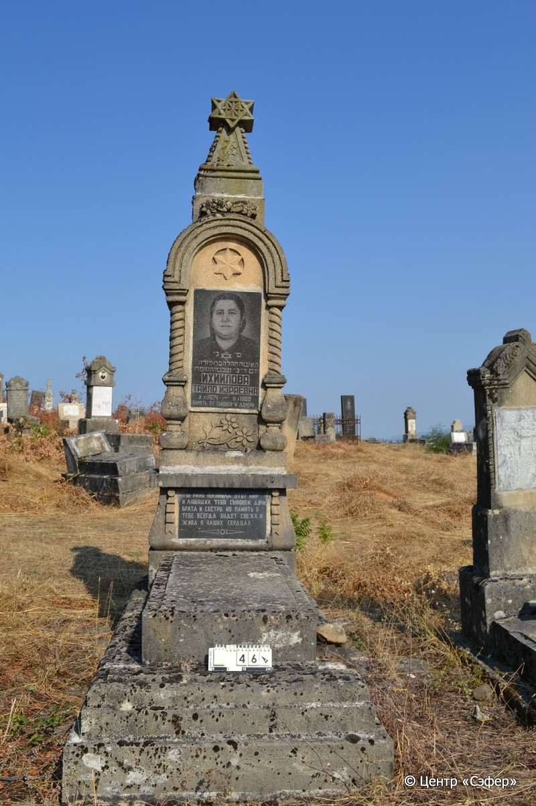
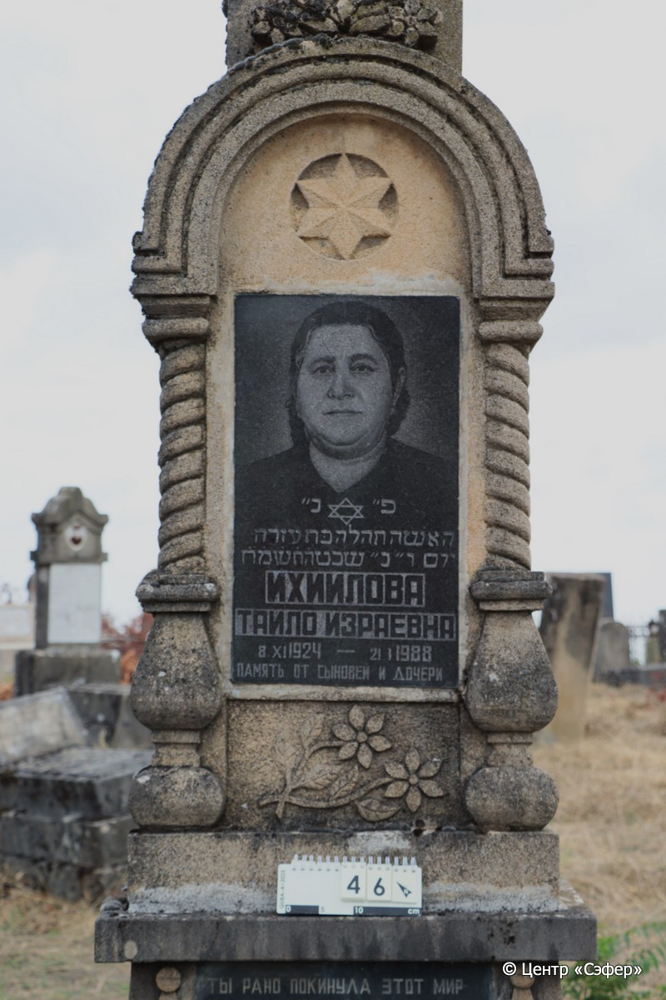
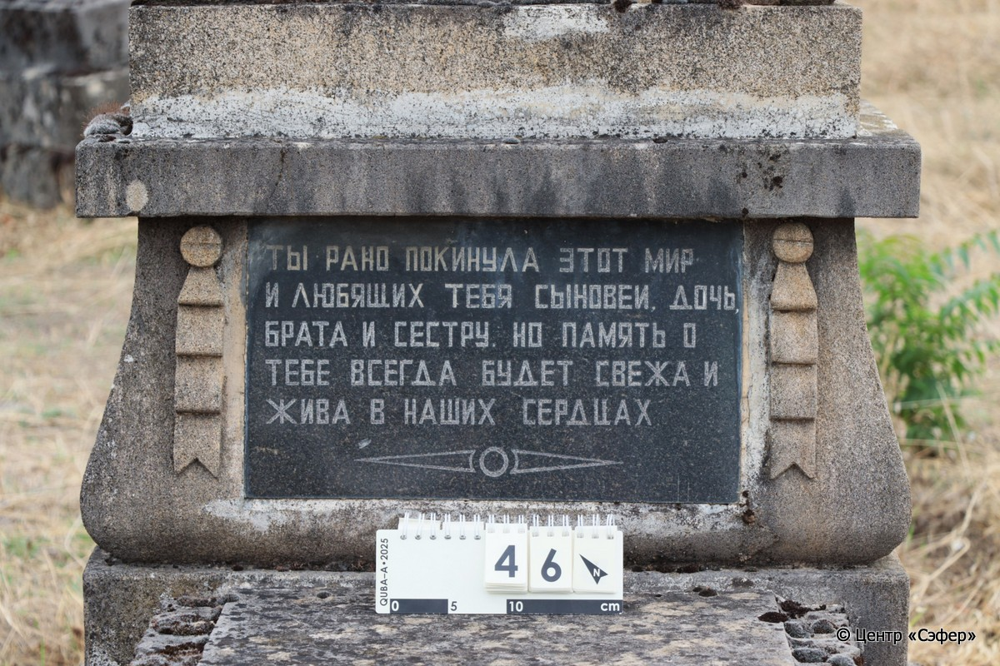

::: {style="font-size: 1em; margin-bottom: 1.2em"}
[Куба (центральное)](../cemeteries/QBA.html) > QBA0046
:::

```{r}
suppressPackageStartupMessages(library(tidyverse))
```


:::: {.columns}

::: {.column width="20%"}

```{r}
#| lightbox:
#|   group: photos





```
:::

::: {.column width="5%"}
:::

::: {.column width="74%"}

::: {.custom-frame}
::: {.name-style}
**ИХИИЛОВА Тахала, дочь Эзры (Тайло Израевна)**
:::

::: {style="font-size: 1.2em; color: #929292;"}
תהלה בת עזרה
:::

:::: {.columns .date-panel .align-items-center}
::: {.column width="1.5em" .text-center}
{width=1.3em .nolightbox}
:::

::: {.column style="width: fit-content; padding-left: 0.4em; padding-right: 4em;"}
08.11.1924 

[--]{style="color: #929292"}
:::

::: {.column width="1.5em" .text-center}
{width=1.3em .nolightbox}
:::

::: {.column style="width: fit-content; padding-left: 0.4em;"}
21.01.1988 

[2.Sh.5748]{style="color: #929292"}
:::

::::

:::

::: {.panel-tabset}

#### Эпитафия

```{r}
tibble(`Оригинал` = "сверху
פ״ נ״
האשה תהלה בת עזרה 
יום ו״ ב״ שבט ה֗ת֗ש֗מ֗ח֗
Ихиилова
Тайло Израевна
8.XI 1924 – 21.I 1988
Память от сыновей и дочери 

снизу
Ты рано покинула этот мир
и любящих тебя сыновей, дочь, 
брата и сестру. Но память о
тебе всегда будет свежа и 
жива в наших сердцах",
       `Перевод` = "_T_
Здесь покоится
женщина Тахала, дочь Эзры.
<Скончалась> в пятницу, 2 швата 5748 <года>.
Ихиилова
Тайло Израевна
8.11.1924 – 21.01.1988
Память от сыновей и дочери

_B_
См. оригинал


") |>
  mutate(`Оригинал` = str_split(`Оригинал`, "
"),
         `Перевод` = str_split(`Перевод`, "
")) |>
  unnest_longer(c(`Оригинал`, `Перевод`)) |> 
  mutate(id = 1:n()) |> 
  relocate(id, .before = Перевод) |> 
  rename(` ` = id) |> 
  knitr::kable(align = c("r", "c", "l"))
```

|||
|-|---|
|Примечания| |
|Язык      |иврит, русский    |
|Метки     |     |
: {.striped .custom-table tbl-colwidths="[25,75]"}

#### Памятник

|||
|-|---|
|Тип памятника   |L-образный                                                                         |
|Материал        |песчаник, мрамор (две темные мраморные вставки с тпкстом и портретом)                                                     |
|Размеры         |260×74×48  --- стела; 18×60×125  --- плита; 40×105×212  --- основание                                                                        |
|Тип декора      |архитектурно-орнаментальный, растительный, традиционная символика, портретный                                                                        |
|Элементы декора |стела: портал с витыми колоннами, навершием в виде звезды Давида с растительным орнаментом в основании, звезда Давида над портретом, под ним - два цветка, по краям нижней надписи - гирлянды в виде лент; плита: края оформлены растительным орнаментом в виде листьев                                                                          |
|Координаты      |[41.36977879, 48.50620691](https://www.google.com/maps/place/41.36977879, 48.50620691)                    |
: {.striped .custom-table tbl-colwidths="[25,75]"}

#### Источник

|                          |                 |
|--------------------------|-----------------|
|Место хранения        |Архив полевых исследований Центра «Сэфер»        |
|Контакты              |students@sefer.ru       |
|Ссылка                |[https://sfira.org](https://sfira.org) |
|Исходный ID           |     |
|Условия использования |[CC BY-NC 4.0](https://creativecommons.org/licenses/by-nc/4.0/deed.ru)        |
: {.striped .custom-table tbl-colwidths="[25,75]"}

:::

:::

::::

