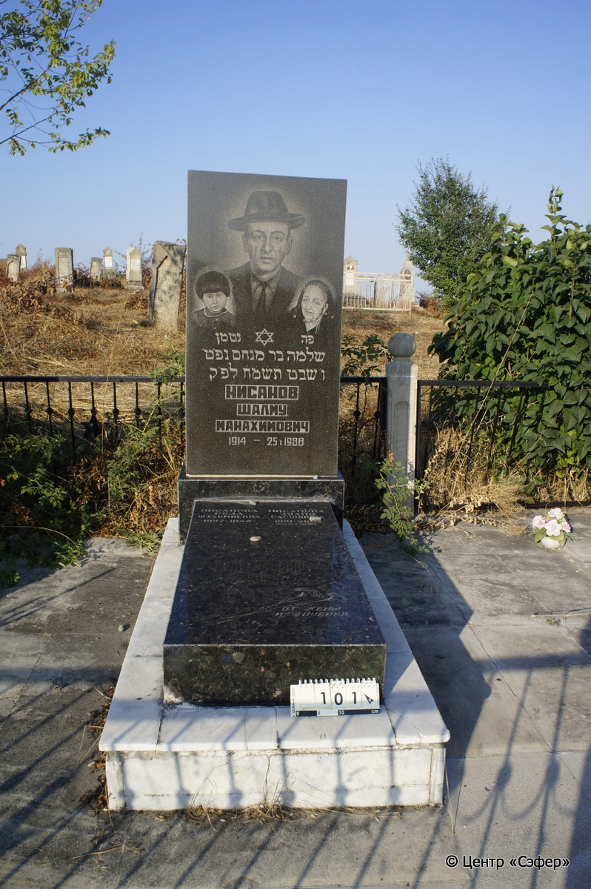
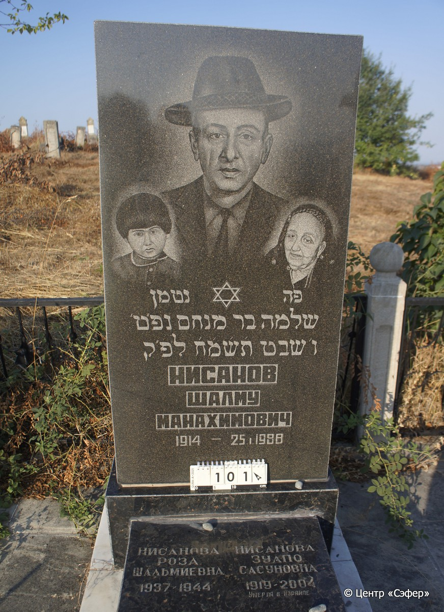
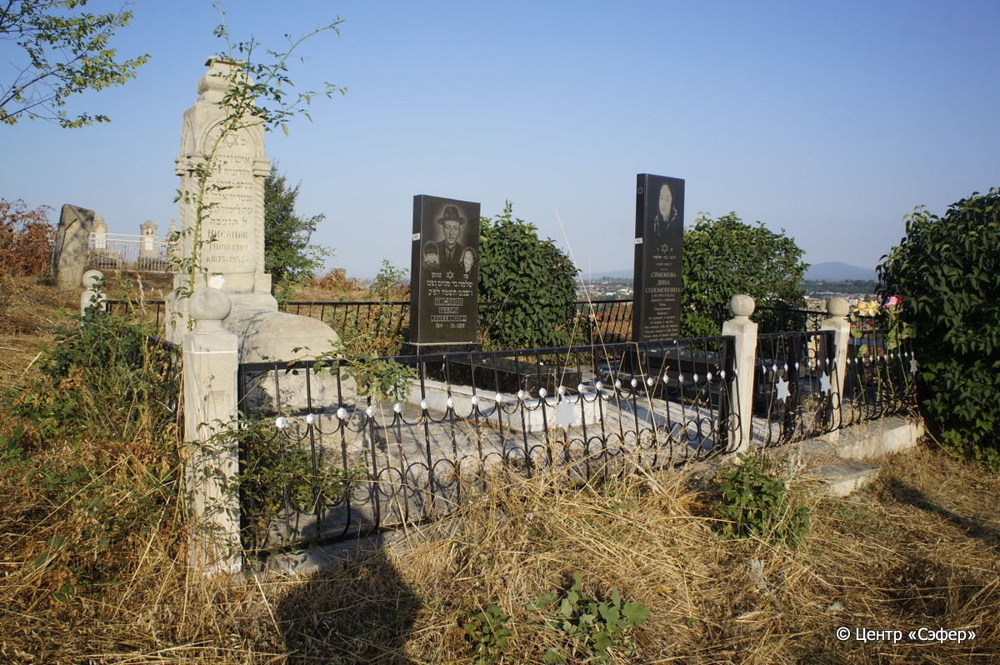

::: {style="font-size: 1em; margin-bottom: 1.2em"}
[Куба (центральное)](../cemeteries/QBA.html) > QBA0101
:::

```{r}
suppressPackageStartupMessages(library(tidyverse))
```


:::: {.columns}

::: {.column width="20%"}

```{r}
#| lightbox:
#|   group: photos





```
:::

::: {.column width="1.5em"}
:::

::: {.column width="74%"}

::: {.custom-frame}
::: {.name-ru-style}
**НИСАНОВ Шломо, сын Менахема (Шалму Манахович)**
:::

::: {.name-he-style}
שלמה בן מנחם
:::

:::: {.columns .date-panel style="display: flex; align-items: top; margin-top: 0.8em;"}
::: {.column .text-center style="width: fit-content; flex: 0 0 auto;"}
{width=1.5em .nolightbox}
:::

::: {.column style="flex: 0 0 auto; width: fit-content; padding-left: 0.8em; padding-right: 3.5em;"}
-.-.1914 

[--]{style="color: #929292"}
:::

::: {.column .text-center style="width: fit-content; flex: 0 0 auto;"}
{width=1.5em .nolightbox}
:::

::: {.column style="flex: 0 0 auto; width: fit-content; padding-left: 0.8em;"}
25.01.1988 

[06.Sh.5748]{style="color: #929292"}
:::

::::

---

::: {.name-ru-style}
**НИСАНОВА Зулпо Сасуновна**
:::

::: {.name-he-style}

:::

:::: {.columns .date-panel style="display: flex; align-items: top; margin-top: 0.8em;"}
::: {.column .text-center style="width: fit-content; flex: 0 0 auto;"}
{width=1.5em .nolightbox}
:::

::: {.column style="flex: 0 0 auto; width: fit-content; padding-left: 0.8em; padding-right: 3.5em;"}
-.-.1919 

[--]{style="color: #929292"}
:::

::: {.column .text-center style="width: fit-content; flex: 0 0 auto;"}
{width=1.5em .nolightbox}
:::

::: {.column style="flex: 0 0 auto; width: fit-content; padding-left: 0.8em;"}
-.-.2004 

[--]{style="color: #929292"}
:::

::::

---

::: {.name-ru-style}
**НИСАНОВА Роза Шальмиевна**
:::

::: {.name-he-style}

:::

:::: {.columns .date-panel style="display: flex; align-items: top; margin-top: 0.8em;"}
::: {.column .text-center style="width: fit-content; flex: 0 0 auto;"}
{width=1.5em .nolightbox}
:::

::: {.column style="flex: 0 0 auto; width: fit-content; padding-left: 0.8em; padding-right: 3.5em;"}
-.-.1944 

[--]{style="color: #929292"}
:::

::: {.column .text-center style="width: fit-content; flex: 0 0 auto;"}
{width=1.5em .nolightbox}
:::

::: {.column style="flex: 0 0 auto; width: fit-content; padding-left: 0.8em;"}
-.-.1944 

[--]{style="color: #929292"}
:::

::::

:::

::: {.panel-tabset}

#### Эпитафия

```{r}
tibble(`Оригинал` = "сверху
פנ נטמן
שלמה בר מנחם נפ׳ט׳
ו׳ שבט ת֗ש֗מ֗ח֗ לפ׳ק
Нисанов
Шалму
Манахович
1914 – 25.I.1988

снизу
справа
Нисанова
Зулпо 
Сасуновна
1919–2004
умерла в Израиле

слева
Нисанова
Роза
Шальмиевна
1937–1944

по центру
от жены
и дочерей",
       `Перевод` = "_T_
Здесь похоронен
Шломо, сын Менахема. Скончался
6 швата 748 <года> по малому исчислению.
Нисанов
Шалму
Манахович
1914 – 25.01.1988

_B_
_R_
 Нисанова
Зулпо
Сасуновна
1919 – 2004
умерла в Израиле

_L_
Нисанова
Роза
Шальмиевна
1937 – 1944

_C_
От жены
и дочерей") |>
  mutate(`Оригинал` = str_split(`Оригинал`, "
"),
         `Перевод` = str_split(`Перевод`, "
")) |>
  unnest_longer(c(`Оригинал`, `Перевод`)) |> 
  mutate(id = 1:n()) |> 
  relocate(id, .before = Перевод) |> 
  rename(` ` = id) |> 
  knitr::kable(align = c("r", "c", "l"))
```

---
::: {.custom-table-wrap}
::: {.list-table .borderless header-rows=0 aligns="l,l" tbl-colwidths="[21,79]"}
- - Примечания
  -  

- - Язык
  - иврит, русский

- - Метки
  -  
:::
:::

#### Памятник

::: {.custom-table-wrap}
::: {.list-table .borderless header-rows=0 aligns="l,l" tbl-colwidths="[21,79]"}
- - Тип памятника
  - L-образный

- - Материал
  - гранит, лабрадорит, мрамор (цементный раствор, трещины, стоит на огражденной платформе из плит)

- - Размеры
  - 140×13×59  --- стела; 17×53×116  --- плита; 20×80×165  --- основание

- - Тип декора
  - традиционная символика, портретный

- - Элементы декора
  - звезда Давида, тройной портрет

- - Координаты
  - 41.37012037, 48.50649399 [Показать на карте](https://www.google.com/maps/place/41.37012037, 48.50649399){style="margin-left: 1em"}
:::
:::

#### Источник

::: {.custom-table-wrap}
::: {.list-table .borderless header-rows=0 aligns="l,l" tbl-colwidths="[21,79]"}
- - Место хранения
  - Архив полевых исследований Центра «Сэфер»

- - Контакты
  - students@sefer.ru

- - Ссылка
  - [https://sfira.org](https://sfira.org)

- - Исходный ID
  -  

- - Условия использования
  - [CC BY-NC 4.0](https://creativecommons.org/licenses/by-nc/4.0/deed.ru)
:::
:::

:::

:::

::::

