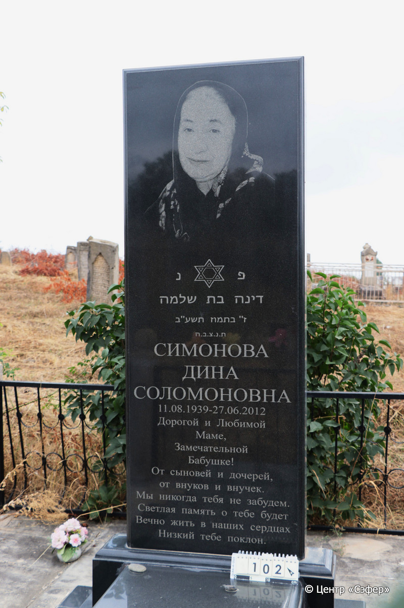
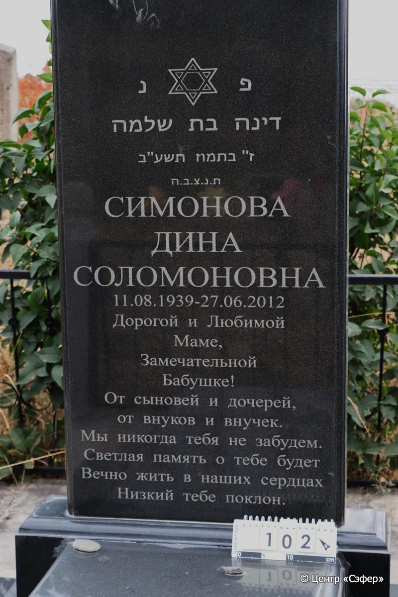
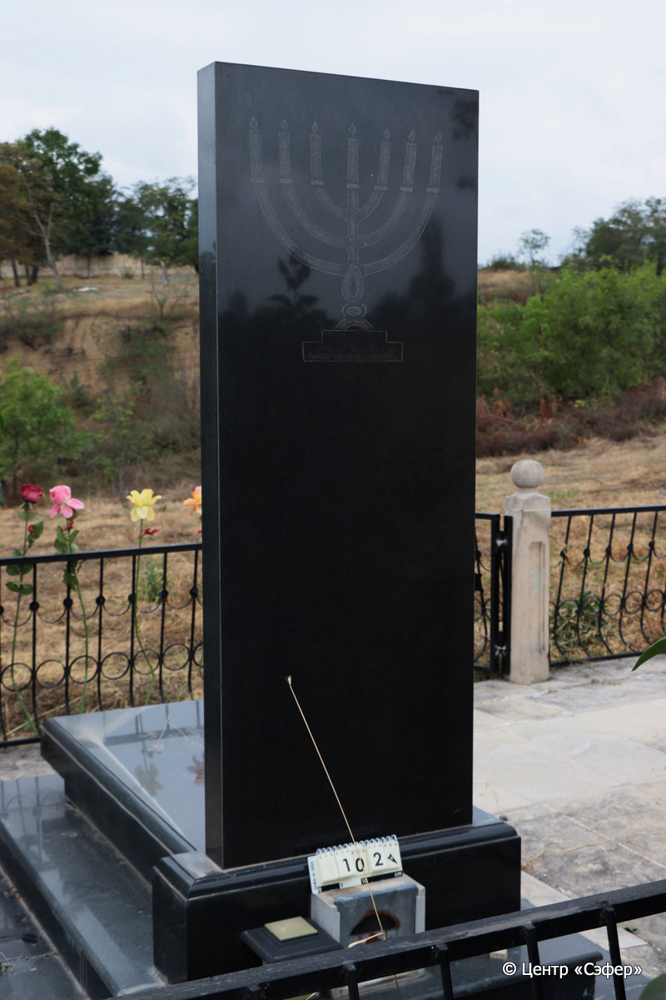
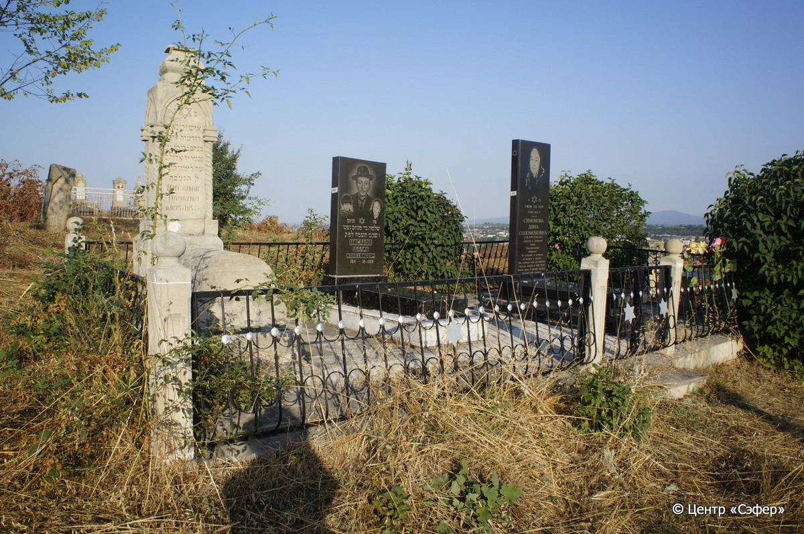

::: {style="font-size: 1em; margin-bottom: 1.2em"}
[Куба (центральное)](../cemeteries/QBA.html) > QBA0102
:::

```{r}
suppressPackageStartupMessages(library(tidyverse))
```


:::: {.columns}

::: {.column width="20%"}

```{r}
#| lightbox:
#|   group: photos






```
:::

::: {.column width="5%"}
:::

::: {.column width="74%"}

::: {.custom-frame}
::: {.name-style}
**СИМОНОВА Дина, дочь Шломо (Соломоновна)**
:::

::: {style="font-size: 1.2em; color: #929292;"}
דינה בת שלמה
:::

:::: {.columns .date-panel .align-items-center}
::: {.column width="1.5em" .text-center}
{width=1.3em .nolightbox}
:::

::: {.column style="width: fit-content; padding-left: 0.4em; padding-right: 4em;"}
11.08.1939 

[--]{style="color: #929292"}
:::

::: {.column width="1.5em" .text-center}
{width=1.3em .nolightbox}
:::

::: {.column style="width: fit-content; padding-left: 0.4em;"}
27.06.2012 

[07.Ta.5772]{style="color: #929292"}
:::

::::

:::

::: {.panel-tabset}

#### Эпитафия

```{r}
tibble(`Оригинал` = "פ נ
דינה בת שלמה
ז״ בתמוז תשע״ב
ת.נ.צ.ב.ה.
Симонова
Дина
Соломоновна
11.08.1939 – 27.06.2012

Дорогой и Любимой
Маме,
Замечательной
Бабушке!
От сыновей и дочерей,
от внуков и внучек.
Мы никогда тебя не забудем.
Светлая память о тебе будет
Вечно жить в наших сердцах
Низкий тебе поклон.",
       `Перевод` = "Здесь покоится
Дина, дочь Шломо.
<Скончалась> 7 таммуза {5}772 <года>.
Да будет душа её завязана в узле жизни.
Симонова
Дина
Соломоновна
11.08.1939 – 27.06.2012

Дорогой и любимой
маме,
замечательной
бабушке!
От сыновей и дочерей,
от внуков и внучек.
Мы никогда тебя не забудем.
Светлая память о тебе будет
вечено жить в наших сердцах.
Низкий тебе поклон.") |>
  mutate(`Оригинал` = str_split(`Оригинал`, "
"),
         `Перевод` = str_split(`Перевод`, "
")) |>
  unnest_longer(c(`Оригинал`, `Перевод`)) |> 
  mutate(id = 1:n()) |> 
  relocate(id, .before = Перевод) |> 
  rename(` ` = id) |> 
  knitr::kable(align = c("r", "c", "l"))
```

|||
|-|---|
|Примечания| |
|Язык      |иврит, русский    |
|Метки     |     |
: {.striped .custom-table tbl-colwidths="[25,75]"}

#### Памятник

|||
|-|---|
|Тип памятника   |L-образный                                                                         |
|Материал        |гранит (цементный раствор, стоит на огражденной платформе из плит)                                                     |
|Размеры         |186×12×60  --- стела; 23×61×130  --- плита; 12×100×192  --- основание                                                                        |
|Тип декора      |растительный, традиционная символика, портретный                                                                        |
|Элементы декора |стела: портрет, звезды Давида на лицевой стороне, по бокам, менора на обратной стороне, плита: две розы, за памятником - два светильника                                                                          |
|Координаты      |[41.37010099, 48.50650268](https://www.google.com/maps/place/41.37010099, 48.50650268)                    |
: {.striped .custom-table tbl-colwidths="[25,75]"}

#### Источник

|                          |                 |
|--------------------------|-----------------|
|Место хранения        |Архив полевых исследований Центра «Сэфер»        |
|Контакты              |students@sefer.ru       |
|Ссылка                |[https://sfira.org](https://sfira.org) |
|Исходный ID           |     |
|Условия использования |[CC BY-NC 4.0](https://creativecommons.org/licenses/by-nc/4.0/deed.ru)        |
: {.striped .custom-table tbl-colwidths="[25,75]"}

:::

:::

::::

