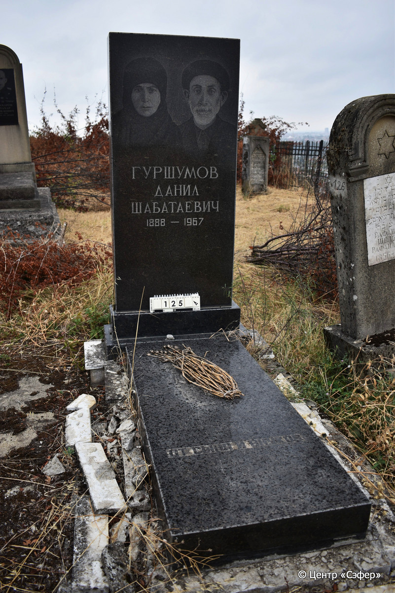
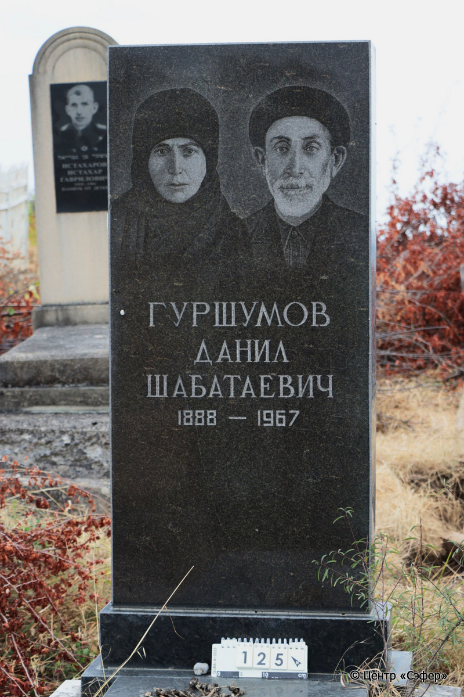

::: {style="font-size: 1em; margin-bottom: 1.2em"}
[Куба (центральное)](../cemeteries/QBA.html) > QBA0125
:::

```{r}
suppressPackageStartupMessages(library(tidyverse))
```


:::: {.columns}

::: {.column width="20%"}

```{r}
#| lightbox:
#|   group: photos




```
:::

::: {.column width="5%"}
:::

::: {.column width="74%"}

::: {.name-style}
ГУРШУМОВ Данил Шабатаевич
:::

::: {style="font-size: 1.2em;"}

:::

:::: {.columns style="margin-top: 1em"}
::: {.column width="5%"}
{width=1.3em .nolightbox}
:::

::: {.column style="width: 40%; padding-left: 0.2em;"}
-.-.1888 [/]{style="color: #adb5bd"} --
:::

::: {.column width="5%"}
{width=1.3em .nolightbox}
:::

::: {.column style="width: 50%; padding-left: 0.2em;"}
-.-.1967 [/]{style="color: #adb5bd"} --
:::

::::


::: {.panel-tabset}

#### Эпитафия

```{r}
tibble(`Оригинал` = "сверху
Гуршумов
Данил
Шабатаевич
1888 – 1967

снизу
От сына и внуков",
       `Перевод` = "_T_
См. оригинал
 
 
 

_B_
См. оригинал") |>
  mutate(`Оригинал` = str_split(`Оригинал`, "
"),
         `Перевод` = str_split(`Перевод`, "
")) |>
  unnest_longer(c(`Оригинал`, `Перевод`)) |> 
  mutate(id = 1:n()) |> 
  relocate(id, .before = Перевод) |> 
  rename(` ` = id) |> 
  knitr::kable(align = c("r", "c", "l"))
```

|||
|-|---|
|**Примечания**| |
|**Язык**      |русский    |
|**Метки**     |     |
: {tbl-colwidths="[25,75]"}

#### Памятник

|||
|-|---|
|**Тип памятника**   |L-образный                                                                         |
|**Материал**        |гранит, лабрадорит, мрамор, бетон (облицовка из мрамора у основания отпала и раскололась, следы эрозии)                                                     |
|**Размеры**         |150×73×30  --- стела; 10×57×131  --- плита; 10×89×194  --- основание                                                                        |
|**Тип декора**      |портретный                                                                        |
|**Элементы декора** |двойной портрет                                                                          |
|**Координаты**      |[41.36974871, 48.50659482](https://www.google.com/maps/place/41.36974871, 48.50659482)                    |
: {tbl-colwidths="[25,75]"}

#### Источник

|                          |                 |
|--------------------------|-----------------|
|**Место хранения**        |Архив полевых исследований Центра «Сэфер»        |
|**Контакты**              |students@sefer.ru       |
|**Ссылка**                |[https://sfira.org](https://sfira.org) |
|**Исходный ID**           |     |
|**Условия использования** |[CC BY-NC 4.0](https://creativecommons.org/licenses/by-nc/4.0/deed.ru)        |
: {tbl-colwidths="[25,75]"}

:::

:::

::::

