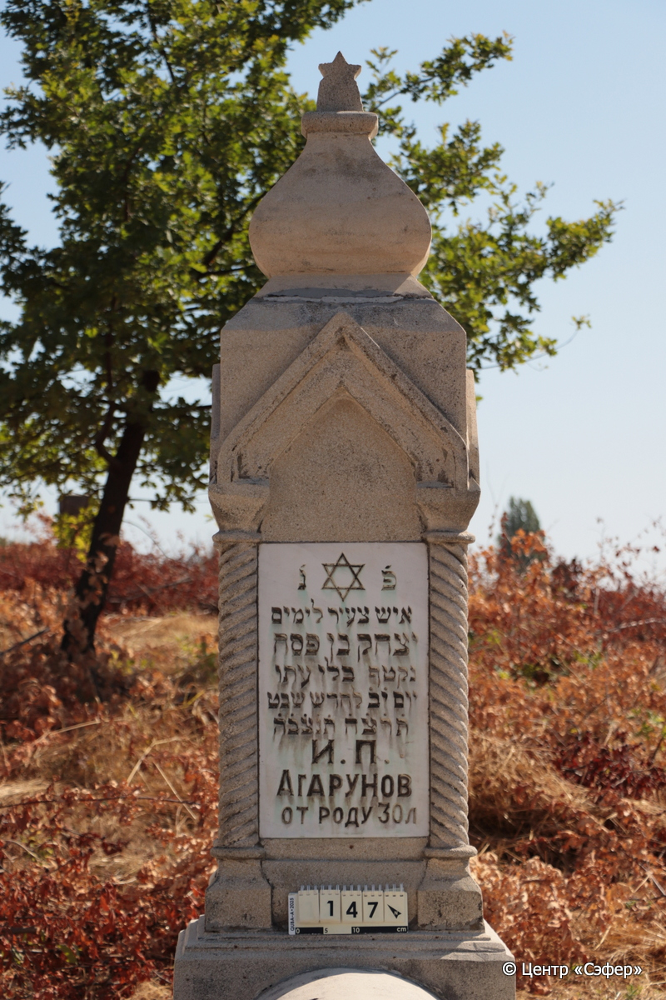
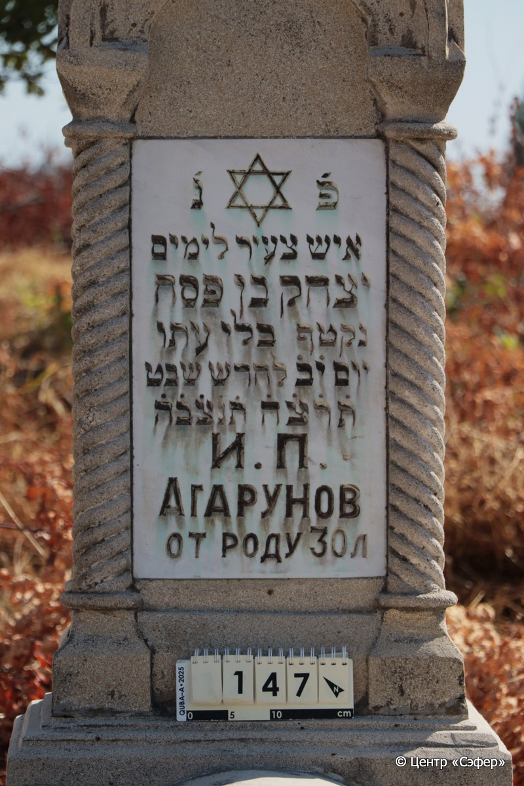
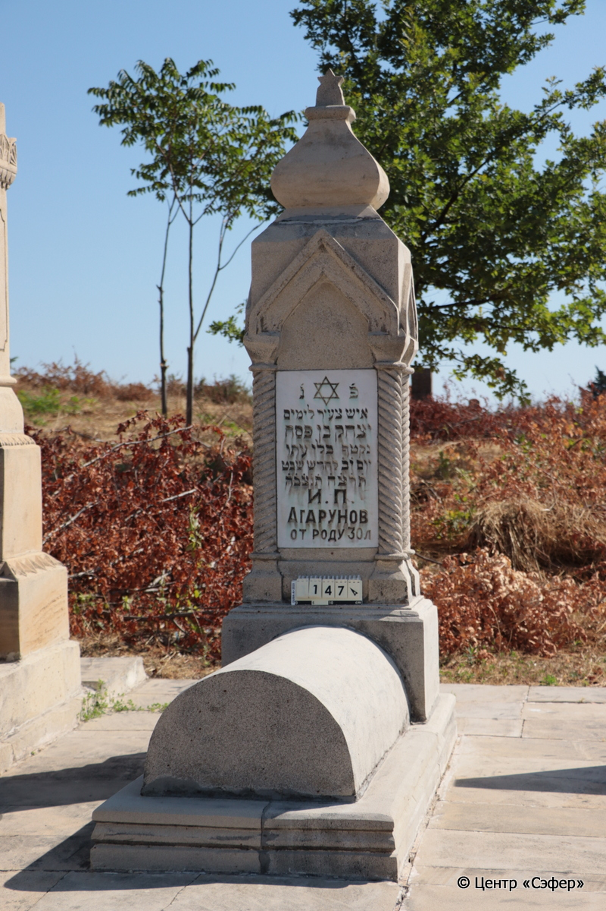

::: {style="font-size: 1em; margin-bottom: 1.2em"}
[Куба (центральное)](../cemeteries/QBA.html) > QBA0147
:::

```{r}
suppressPackageStartupMessages(library(tidyverse))
```


:::: {.columns}

::: {.column width="20%"}

```{r}
#| lightbox:
#|   group: photos





```
:::

::: {.column width="5%"}
:::

::: {.column width="74%"}

::: {.custom-frame}
::: {.name-style}
**АГАРУНОВ Ицхак, сын Песаха (Исхог Писахович)**
:::

::: {style="font-size: 1.2em; color: #929292;"}
יצחק בן פסח
:::

:::: {.columns .date-panel .align-items-center}
::: {.column width="1.5em" .text-center}
{width=1.3em .nolightbox}
:::

::: {.column style="width: fit-content; padding-left: 0.4em; padding-right: 4em;"}
-- 

[--]{style="color: #929292"}
:::

::: {.column width="1.5em" .text-center}
{width=1.3em .nolightbox}
:::

::: {.column style="width: fit-content; padding-left: 0.4em;"}
16.01.1935* 

[12.Sh.5695]{style="color: #929292"}
:::

::::

:::

::: {.panel-tabset}

#### Эпитафия

```{r}
tibble(`Оригинал` = "פ׳ נ׳
איש צעיר לימים
יצחק בן פסח
נקטף בלי עתו
יום י֗ב֗ לחדש שבט
ת֗ר֗צ֗ה֗ ת֗נ֗צ֗ב֗ה֗
И.П.
Агарунов
от роду 30 л",
       `Перевод` = "Здесь покоится
молодой человек
Ицхак, сын Песаха,
сорванный безвременно
на 12 день месяца швата,
{5}695 <года>. Да будет душа его завязана в узле жизни.
И[цхак]. П[есахович].
Агарунов,
30 лет от роду") |>
  mutate(`Оригинал` = str_split(`Оригинал`, "
"),
         `Перевод` = str_split(`Перевод`, "
")) |>
  unnest_longer(c(`Оригинал`, `Перевод`)) |> 
  mutate(id = 1:n()) |> 
  relocate(id, .before = Перевод) |> 
  rename(` ` = id) |> 
  knitr::kable(align = c("r", "c", "l"))
```

|||
|-|---|
|Примечания| |
|Язык      |иврит, русский    |
|Метки     |преждевременная смерть    |
: {.striped .custom-table tbl-colwidths="[25,75]"}

#### Памятник

|||
|-|---|
|Тип памятника   |L-образный                                                                         |
|Материал        |известняк, мрамор (мраморная вставка для текста, цементный раствор, следы эрозии)                                                     |
|Размеры         |196×61×44  --- стела; 30×50×105  --- Саркофаг; 12×69×173  --- основание                                                                        |
|Тип декора      |архитектурно-орнаментальный, традиционная символика                                                                        |
|Элементы декора |навершие с фрагментом звёзды, текст помещен в стрельчатые арки, стоящие на витых полуколоннах, звезда Давида на текстовой вставке                                                                          |
|Координаты      |[41.3702946, 48.50643952](https://www.google.com/maps/place/41.3702946, 48.50643952)                    |
: {.striped .custom-table tbl-colwidths="[25,75]"}

#### Источник

|                          |                 |
|--------------------------|-----------------|
|Место хранения        |Архив полевых исследований Центра «Сэфер»        |
|Контакты              |students@sefer.ru       |
|Ссылка                |[https://sfira.org](https://sfira.org) |
|Исходный ID           |     |
|Условия использования |[CC BY-NC 4.0](https://creativecommons.org/licenses/by-nc/4.0/deed.ru)        |
: {.striped .custom-table tbl-colwidths="[25,75]"}

:::

:::

::::

