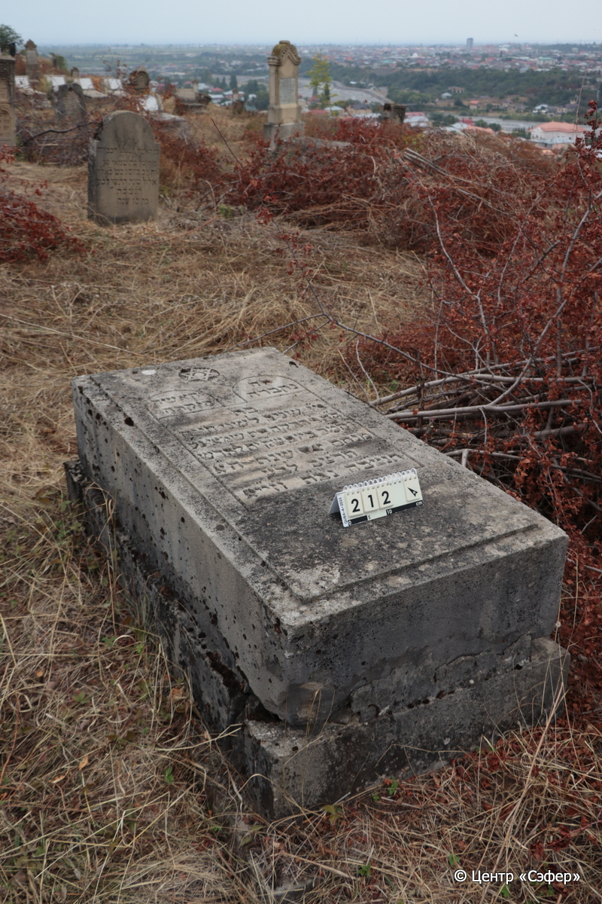
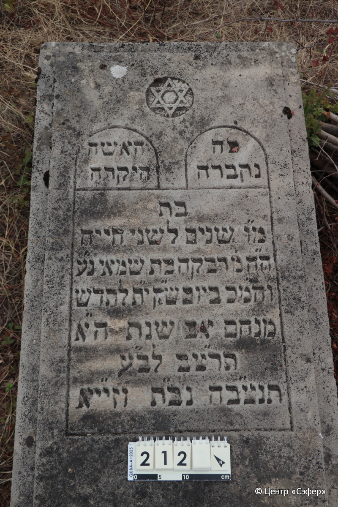
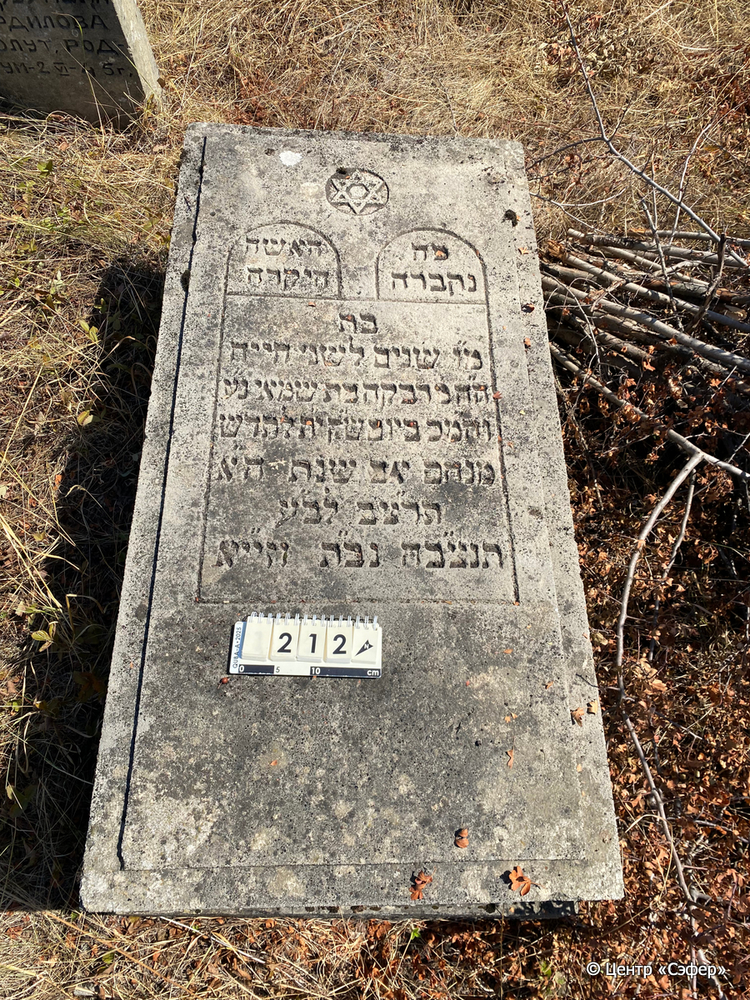

::: {style="font-size: 1em; margin-bottom: 1.2em"}
[Куба (центральное)](../cemeteries/QBA.html) > QBA0212
:::

```{r}
suppressPackageStartupMessages(library(tidyverse))
```


:::: {.columns}

::: {.column width="20%"}

```{r}
#| lightbox:
#|   group: photos





```
:::

::: {.column width="1.5em"}
:::

::: {.column width="74%"}

::: {.custom-frame}
::: {.name-ru-style}
**Ривка, дочь Шамая**
:::

::: {.name-he-style}
רבקה בת שמאי
:::

:::: {.columns .date-panel style="display: flex; align-items: center; margin-top: 0.8em;"}
::: {.column .text-center style="width: fit-content; flex: 0 0 auto;"}
{width=1.5em .nolightbox}
:::

::: {.column style="flex: 0 0 auto; width: fit-content; padding-left: 0.8em; padding-right: 3.5em;"}
-- 

[--]{style="color: #929292"}
:::

::: {.column .text-center style="width: fit-content; flex: 0 0 auto;"}
{width=1.5em .nolightbox}
:::

::: {.column style="flex: 0 0 auto; width: fit-content; padding-left: 0.8em;"}
20.08.1932* 

[18.Av.5692]{style="color: #929292"}
:::

::::

:::

::: {.panel-tabset}

#### Эпитафия

```{r}
tibble(`Оригинал` = "справа
פה
נקברה

слева
האשה
היקרה

по центру
בת
מ״ו שנים לשני חייה
ה״ה מ׳ רבקה בת שמאי נ״ע
וה״מכ ביום ש״ק י״[ח] ל[ח]דש
מנחם אב שנת ה״א
תרצ״ב לב״ע
תנצ״בה נב״ת וזי״יא",
       `Перевод` = "_R_
Здесь
покоится

_L_
женщина
дорогая,

_C_
в возрасте
46 лет жизни
г-жа Ривка, дочь Шаммая, душа ее в раю
и благословен ее покой. В день святой субблты, 1[8] числа месяца
менахем ав года
5692 от сотворения мира.
Да будет душа ее завязана в узле жизни, упокоится душа ее в раю, и род ее унаследует землю.*") |>
  mutate(`Оригинал` = str_split(`Оригинал`, "
"),
         `Перевод` = str_split(`Перевод`, "
")) |>
  unnest_longer(c(`Оригинал`, `Перевод`)) |> 
  mutate(id = 1:n()) |> 
  relocate(id, .before = Перевод) |> 
  rename(` ` = id) |> 
  knitr::kable(align = c("r", "c", "l"))
```

---

::: {.list-table .striped .custom-table .borderless header-rows=0 aligns="l,l" tbl-colwidths="[21,79]"}
- - Примечания
  - * Псалмы 25:13

- - Язык
  - иврит

- - Метки
  -  
:::

#### Памятник

::: {.list-table .striped .custom-table .borderless header-rows=0 aligns="l,l" tbl-colwidths="[21,79]"}
- - Тип памятника
  - плита/саркофаг

- - Материал
  - известняк (цементный раствор, следы эрозии, сколы)

- - Размеры
  - 29×70×143  --- плита; 26×90×164  --- основание

- - Тип декора
  - архитектурно-орнаментальный, традиционная символика

- - Элементы декора
  - звезда Давида в круглой нише, фигурная рамка для текста

- - Координаты
  - 41.3702612, 48.50679107 [[]{style="vertical-align: middle;"} Смотреть на карте](https://www.google.com/maps/place/41.3702612, 48.50679107){.btn .btn-outline-info role="button"}
:::

#### Источник

::: {.list-table .striped .custom-table .borderless header-rows=0 aligns="l,l" tbl-colwidths="[21,79]"}
- - Место хранения
  - Архив полевых исследований Центра «Сэфер»

- - Контакты
  - students@sefer.ru

- - Ссылка
  - [https://sfira.org](https://sfira.org)

- - Исходный ID
  -  

- - Условия использования
  - [CC BY-NC 4.0](https://creativecommons.org/licenses/by-nc/4.0/deed.ru)
:::

:::

:::

::::

