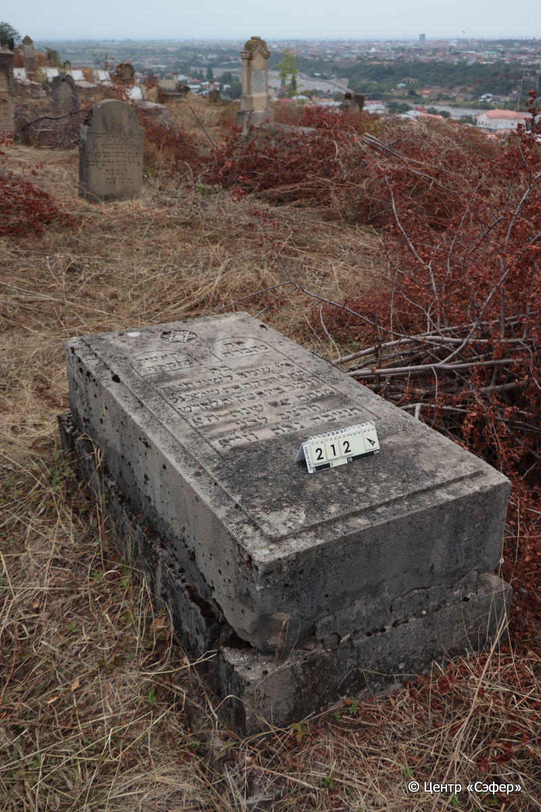
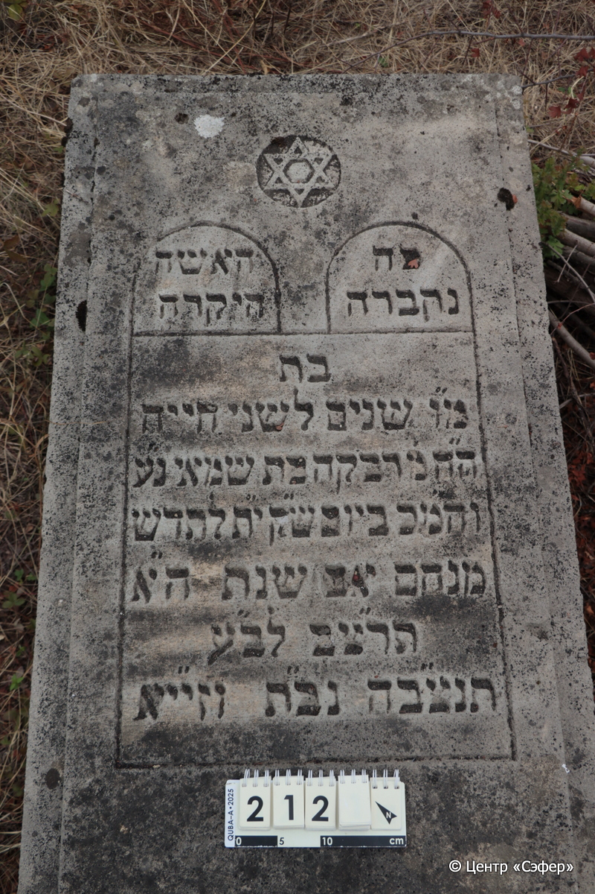
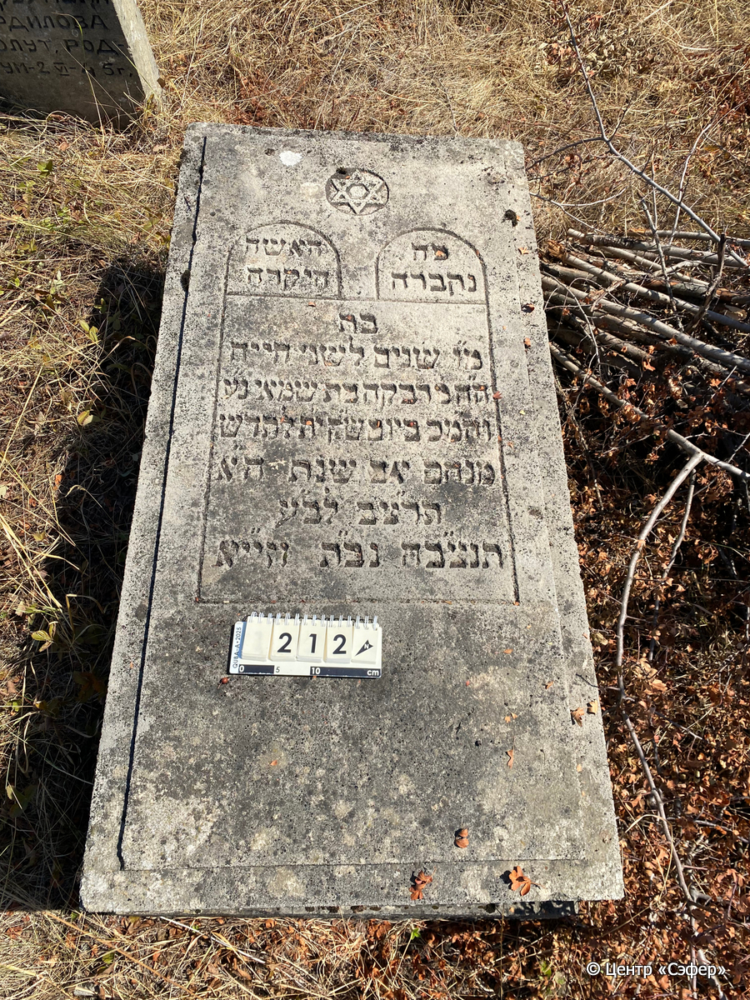

::: {style="font-size: 1em; margin-bottom: 1.2em"}
[Куба (центральное)](../cemeteries/QBA.html) > QBA0212
:::

```{r}
suppressPackageStartupMessages(library(tidyverse))
```


:::: {.columns}

::: {.column width="20%"}

```{r}
#| lightbox:
#|   group: photos





```
:::

::: {.column width="5%"}
:::

::: {.column width="74%"}

::: {.custom-frame}
::: {.name-style}
**Ривка, дочь Шамая**
:::

::: {style="font-size: 1.2em; color: #929292;"}
רבקה בת שמאי
:::

:::: {.columns .date-panel .align-items-center}
::: {.column width="1.5em" .text-center}
{width=1.3em .nolightbox}
:::

::: {.column style="width: fit-content; padding-left: 0.4em; padding-right: 4em;"}
-- 

[--]{style="color: #929292"}
:::

::: {.column width="1.5em" .text-center}
{width=1.3em .nolightbox}
:::

::: {.column style="width: fit-content; padding-left: 0.4em;"}
20.08.1932* 

[18.Av.5692]{style="color: #929292"}
:::

::::

:::

::: {.panel-tabset}

#### Эпитафия

```{r}
tibble(`Оригинал` = "справа
פה
נקברה

слева
האשה
היקרה

по центру
בת
מ״ו שנים לשני חייה
ה״ה מ׳ רבקה בת שמאי נ״ע
וה״מכ ביום ש״ק י״[ח] ל[ח]דש
מנחם אב שנת ה״א
תרצ״ב לב״ע
תנצ״בה נב״ת וזי״יא",
       `Перевод` = "_R_
Здесь
покоится

_L_
женщина
дорогая,

_C_
в возрасте
46 лет жизни
г-жа Ривка, дочь Шаммая, душа ее в раю
и благословен ее покой. В день святой субблты, 1[8] числа месяца
менахем ав года
5692 от сотворения мира.
Да будет душа ее завязана в узле жизни, упокоится душа ее в раю, и род ее унаследует землю.*") |>
  mutate(`Оригинал` = str_split(`Оригинал`, "
"),
         `Перевод` = str_split(`Перевод`, "
")) |>
  unnest_longer(c(`Оригинал`, `Перевод`)) |> 
  mutate(id = 1:n()) |> 
  relocate(id, .before = Перевод) |> 
  rename(` ` = id) |> 
  knitr::kable(align = c("r", "c", "l"))
```

|||
|-|---|
|Примечания|* Псалмы 25:13|
|Язык      |иврит    |
|Метки     |     |
: {.striped .custom-table tbl-colwidths="[25,75]"}

#### Памятник

|||
|-|---|
|Тип памятника   |плита/саркофаг                                                                         |
|Материал        |известняк (цементный раствор, следы эрозии, сколы)                                                     |
|Размеры         |29×70×143  --- плита; 26×90×164  --- основание                                                                        |
|Тип декора      |архитектурно-орнаментальный, традиционная символика                                                                        |
|Элементы декора |звезда Давида в круглой нише, фигурная рамка для текста                                                                          |
|Координаты      |[41.3702612, 48.50679107](https://www.google.com/maps/place/41.3702612, 48.50679107)                    |
: {.striped .custom-table tbl-colwidths="[25,75]"}

#### Источник

|                          |                 |
|--------------------------|-----------------|
|Место хранения        |Архив полевых исследований Центра «Сэфер»        |
|Контакты              |students@sefer.ru       |
|Ссылка                |[https://sfira.org](https://sfira.org) |
|Исходный ID           |     |
|Условия использования |[CC BY-NC 4.0](https://creativecommons.org/licenses/by-nc/4.0/deed.ru)        |
: {.striped .custom-table tbl-colwidths="[25,75]"}

:::

:::

::::

