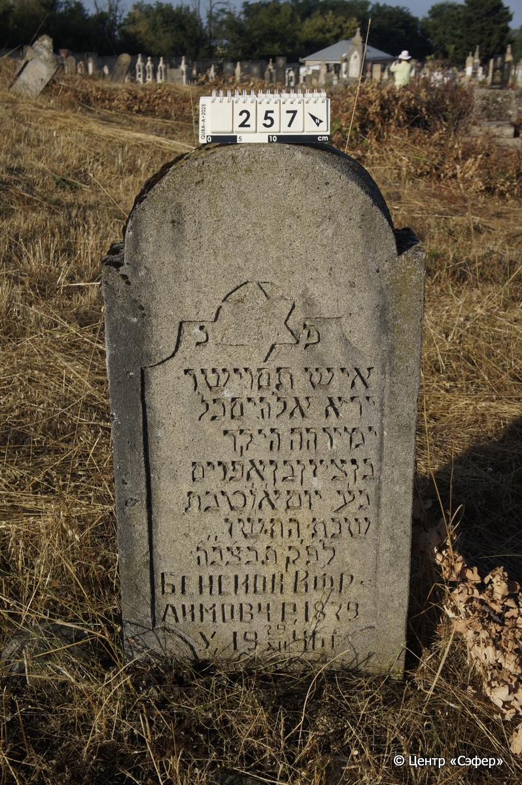

::: {style="font-size: 1em; margin-bottom: 1.2em"}
[Куба (центральное)](../cemeteries/QBA.html) > QBA0257
:::

```{r}
suppressPackageStartupMessages(library(tidyverse))
```


:::: {.columns}

::: {.column width="20%"}

```{r}
#| lightbox:
#|   group: photos



```
:::

::: {.column width="5%"}
:::

::: {.column width="74%"}

::: {.custom-frame}
::: {.name-style}
**Бен Цион, сын Эфраима**
:::

::: {style="font-size: 1.2em; color: #929292;"}
בן ציון בן אפרים
:::

:::: {.columns .date-panel .align-items-center}
::: {.column width="1.5em" .text-center}
{width=1.3em .nolightbox}
:::

::: {.column style="width: fit-content; padding-left: 0.4em; padding-right: 4em;"}
-.-.1879 

[--]{style="color: #929292"}
:::

::: {.column width="1.5em" .text-center}
{width=1.3em .nolightbox}
:::

::: {.column style="width: fit-content; padding-left: 0.4em;"}
29.12.1946 

[06.Te.5706]{style="color: #929292"}
:::

::::

:::

::: {.panel-tabset}

#### Эпитафия

```{r}
tibble(`Оригинал` = "פ נ
איש תם וישר
ירא אלהים כל
ימיו ה׳ה היקר
בן ציון בן אפרים
נ׳ע יום א׳ ו׳ טבת
שנת ה֗ת֗ש֗ו֗
ל֗פ֗׳ק֗ ת֗נ֗צ֗ב֗״ה֗
Бенсион Ифр-
аимовч р. 1879
у. 29/XII 1946 г.",
       `Перевод` = "Здесь покоится
человек честный и прямодушный,
богобоязненный все
дни свои, дорогой г-н
Бен Цион, сын Эфраима,
душа его в раю. Воскресенье, 6 тевета
года 5706
по малому летоисчислению. Да будет душа его завязана в узле жизни.
Бенсион Ифраимович.-
Родился в 1879 г.,
умер 29.12.1946 г.") |>
  mutate(`Оригинал` = str_split(`Оригинал`, "
"),
         `Перевод` = str_split(`Перевод`, "
")) |>
  unnest_longer(c(`Оригинал`, `Перевод`)) |> 
  mutate(id = 1:n()) |> 
  relocate(id, .before = Перевод) |> 
  rename(` ` = id) |> 
  knitr::kable(align = c("r", "c", "l"))
```

|||
|-|---|
|Примечания| |
|Язык      |иврит, русский    |
|Метки     |     |
: {.striped .custom-table tbl-colwidths="[25,75]"}

#### Памятник

|||
|-|---|
|Тип памятника   |стела                                                                         |
|Материал        |известняк (следы эрозии)                                                     |
|Размеры         |109×55×18                                                                        |
|Тип декора      |архитектурно-орнаментальный, традиционная символика                                                                        |
|Элементы декора |фигурная ниша для текста; звезда Давида наверху ниши для текста в круге; округлое завершение                                                                          |
|Координаты      |[41.37053802, 48.50690401](https://www.google.com/maps/place/41.37053802, 48.50690401)                    |
: {.striped .custom-table tbl-colwidths="[25,75]"}

#### Источник

|                          |                 |
|--------------------------|-----------------|
|Место хранения        |Архив полевых исследований Центра «Сэфер»        |
|Контакты              |students@sefer.ru       |
|Ссылка                |[https://sfira.org](https://sfira.org) |
|Исходный ID           |     |
|Условия использования |[CC BY-NC 4.0](https://creativecommons.org/licenses/by-nc/4.0/deed.ru)        |
: {.striped .custom-table tbl-colwidths="[25,75]"}

:::

:::

::::

