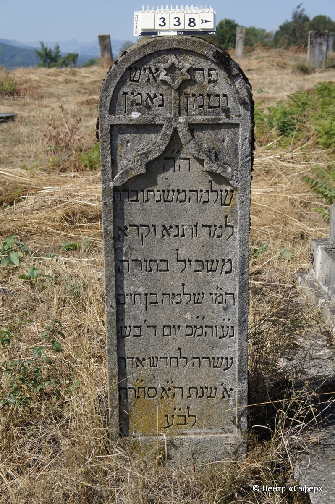

::: {style="font-size: 1em; margin-bottom: 1.2em"}
[Куба (центральное)](../cemeteries/QBA.html) > QBA0338
:::

```{r}
suppressPackageStartupMessages(library(tidyverse))
```


:::: {.columns}

::: {.column width="20%"}

```{r}
#| lightbox:
#|   group: photos



```
:::

::: {.column width="5%"}
:::

::: {.column width="74%"}

::: {.name-style}
Шломо, сын Хаима
:::

::: {style="font-size: 1.2em;"}
שלמה בן חיים
:::

:::: {.columns style="margin-top: 1em"}
::: {.column width="5%"}
{width=1.3em .nolightbox}
:::

::: {.column style="width: 40%; padding-left: 0.2em;"}
-- [/]{style="color: #adb5bd"} --
:::

::: {.column width="5%"}
{width=1.3em .nolightbox}
:::

::: {.column style="width: 50%; padding-left: 0.2em;"}
25.02.1885* [/]{style="color: #adb5bd"} 10.Ad.5645
:::

::::


::: {.panel-tabset}

#### Эпитафия

```{r}
tibble(`Оригинал` = "справа
פה
נטמן

слева
איש
נאמן

по центру
ה״ה
שלמה משנתו ברה
למד ותנא וקרא
משכיל בתורה
המ״ו שלמה בן חיים
נ״ע והמ״כ יום ד׳ בש׳
עשרה לחדש אדר
א׳ שנת ה״א סת״רה
לב״ע",
       `Перевод` = "_R_
Здесь
похоронен

_L_
Человек
верный

_C_
И вот,
Шломо, [...]
учил, повторял и читал,
просвещённый в Торе,
наш учитель, Шломо, сын Хаима.
Да покоится с миром. Скончался в среду,
10-го  адара-I,
года 5645
от сотворения мира.") |>
  mutate(`Оригинал` = str_split(`Оригинал`, "
"),
         `Перевод` = str_split(`Перевод`, "
")) |>
  unnest_longer(c(`Оригинал`, `Перевод`)) |> 
  mutate(id = 1:n()) |> 
  relocate(id, .before = Перевод) |> 
  rename(` ` = id) |> 
  knitr::kable(align = c("r", "c", "l"))
```

|||
|-|---|
|**Примечания**|Первые буквы строк образуют акростих с именем покойного - Шломо.|
|**Язык**      |иврит    |
|**Метки**     |знаток Писания    |
: {tbl-colwidths="[25,75]"}

#### Памятник

|||
|-|---|
|**Тип памятника**   |стела                                                                         |
|**Материал**        |известняк (следы эрозии)                                                     |
|**Размеры**         |128×40×20  --- стела                                                                        |
|**Тип декора**      |традиционная символика                                                                        |
|**Элементы декора** |полукруглое завершение со звездой Давида и резная рамка для текста                                                                          |
|**Координаты**      |[41.37086628, 48.50728414](https://www.google.com/maps/place/41.37086628, 48.50728414)                    |
: {tbl-colwidths="[25,75]"}

#### Источник

|                          |                 |
|--------------------------|-----------------|
|**Место хранения**        |Архив полевых исследований Центра «Сэфер»        |
|**Контакты**              |students@sefer.ru       |
|**Ссылка**                |[https://sfira.org](https://sfira.org) |
|**Исходный ID**           |     |
|**Условия использования** |[CC BY-NC 4.0](https://creativecommons.org/licenses/by-nc/4.0/deed.ru)        |
: {tbl-colwidths="[25,75]"}

:::

:::

::::

