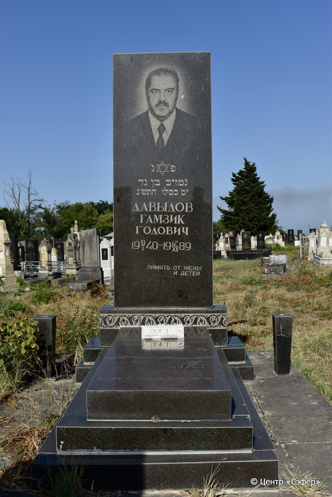
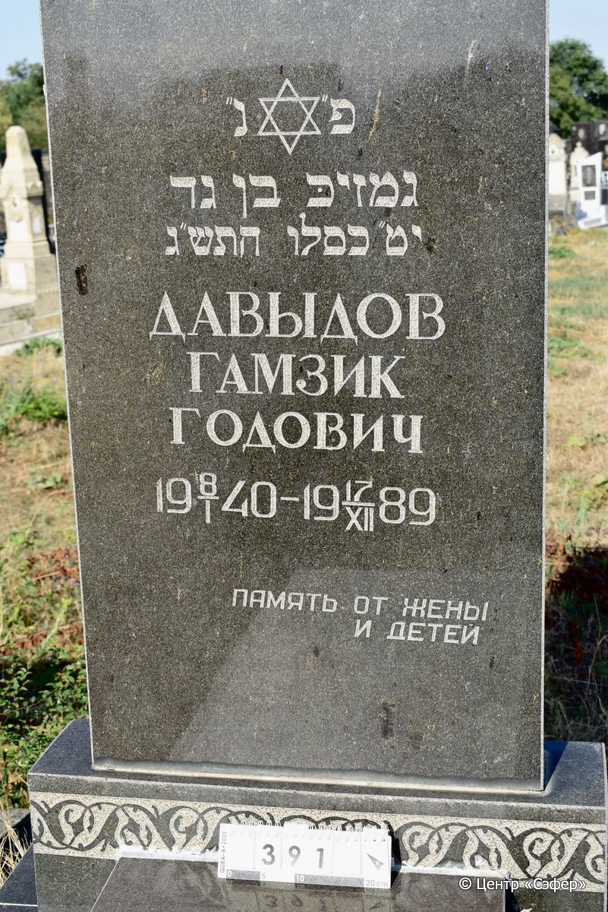
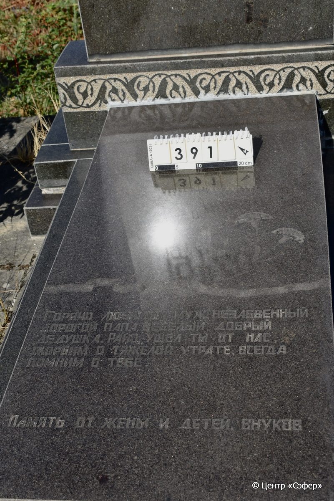

::: {style="font-size: 1em; margin-bottom: 1.2em"}
[Куба (центральное)](../cemeteries/QBA.html) > QBA0391
:::

```{r}
suppressPackageStartupMessages(library(tidyverse))
```


:::: {.columns}

::: {.column width="20%"}

```{r}
#| lightbox:
#|   group: photos





```
:::

::: {.column width="1.5em"}
:::

::: {.column width="74%"}

::: {.custom-frame}
::: {.name-ru-style}
**ДАВЫДОВ Гамзик, сын Гада (Годович)**
:::

::: {.name-he-style}
גמזיכּ בן גד
:::

:::: {.columns .date-panel style="display: flex; align-items: top; margin-top: 0.8em;"}
::: {.column .text-center style="width: fit-content; flex: 0 0 auto;"}
{width=1.5em .nolightbox}
:::

::: {.column style="flex: 0 0 auto; width: fit-content; padding-left: 0.8em; padding-right: 3.5em;"}
08.01.1940 

[--]{style="color: #929292"}
:::

::: {.column .text-center style="width: fit-content; flex: 0 0 auto;"}
{width=1.5em .nolightbox}
:::

::: {.column style="flex: 0 0 auto; width: fit-content; padding-left: 0.8em;"}
17.12.1989 

[19.Ki.5750]{style="color: #929292"}
:::

::::

:::

::: {.panel-tabset}

#### Эпитафия

```{r}
tibble(`Оригинал` = "сверху
פ״ נ״
גמזיכּ בן גד
 י״ט כסלו התש״נ
Давыдов
Гамзик
Годович
 8 I 1940 - 17 XII 1989 
Память от жены и детей

снизу
Горячо любимый муж незабвенный
дорогой папа весёлый добрый
дедушка рано ушёл ты от нас,
скорбим о тяжёлой утрате всегда
помним о тебе.
память от жены и детей, внуков",
       `Перевод` = "_T_
Здесь покоится
Гамзик, сын Года.
<Скончался> 19 кислева, 5750 года.
Давыдов
Гамзик
Годович
 08.01.1940 – 17.12.1989 
Память от жены и детей

_B_
Горячо любимый муж незабвенный
дорогой папа весёлый добрый
дедушка рано ушёл ты от нас,
скорбим о тяжёлой утрате всегда
помним о тебе.
память от жены и детей, внуков") |>
  mutate(`Оригинал` = str_split(`Оригинал`, "
"),
         `Перевод` = str_split(`Перевод`, "
")) |>
  unnest_longer(c(`Оригинал`, `Перевод`)) |> 
  mutate(id = 1:n()) |> 
  relocate(id, .before = Перевод) |> 
  rename(` ` = id) |> 
  knitr::kable(align = c("r", "c", "l"))
```

---

:::: {.custom-table-wrap}
::: {.list-table .borderless header-rows=0 aligns="l,l" tbl-colwidths="[21,79]"}
- - Примечания
  -  

- - Язык
  - иврит, русский

- - Метки
  -  

:::
::::

#### Памятник

:::: {.custom-table-wrap}
::: {.list-table .borderless header-rows=0 aligns="l,l" tbl-colwidths="[21,79]"}
- - Тип памятника
  - L-образный

- - Материал
  - лабрадорит (цементный раствор, трещины на вазах и основании)

- - Размеры
  - 197×85×21  --- стела; 13×57×136  --- плита; 21×116×192  --- основание

- - Тип декора
  - растительный, традиционная символика, портретный

- - Элементы декора
  - портрет, звезда Давида, пояс с растительным мотивом на основании стелы, на плите две гвоздики и лента

- - Координаты
  - 41.37091279, 48.50755038 [Показать на карте](https://www.google.com/maps/place/41.37091279, 48.50755038){style="margin-left: 1em"}

:::
::::

#### Источник

:::: {.custom-table-wrap}
::: {.list-table .borderless header-rows=0 aligns="l,l" tbl-colwidths="[21,79]"}
- - Место хранения
  - Архив полевых исследований Центра «Сэфер»

- - Контакты
  - students@sefer.ru

- - Ссылка
  - [https://sfira.org](https://sfira.org)

- - Исходный ID
  -  

- - Условия использования
  - [CC BY-NC 4.0](https://creativecommons.org/licenses/by-nc/4.0/deed.ru)

:::
::::

:::

:::

:::

