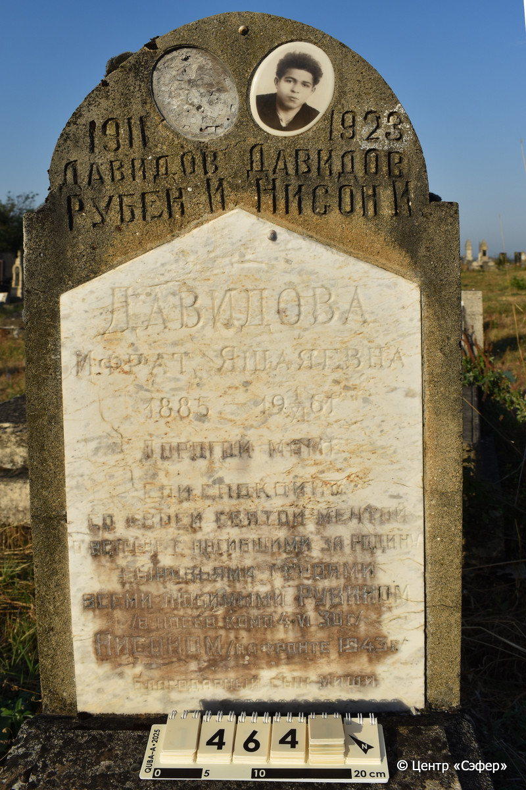
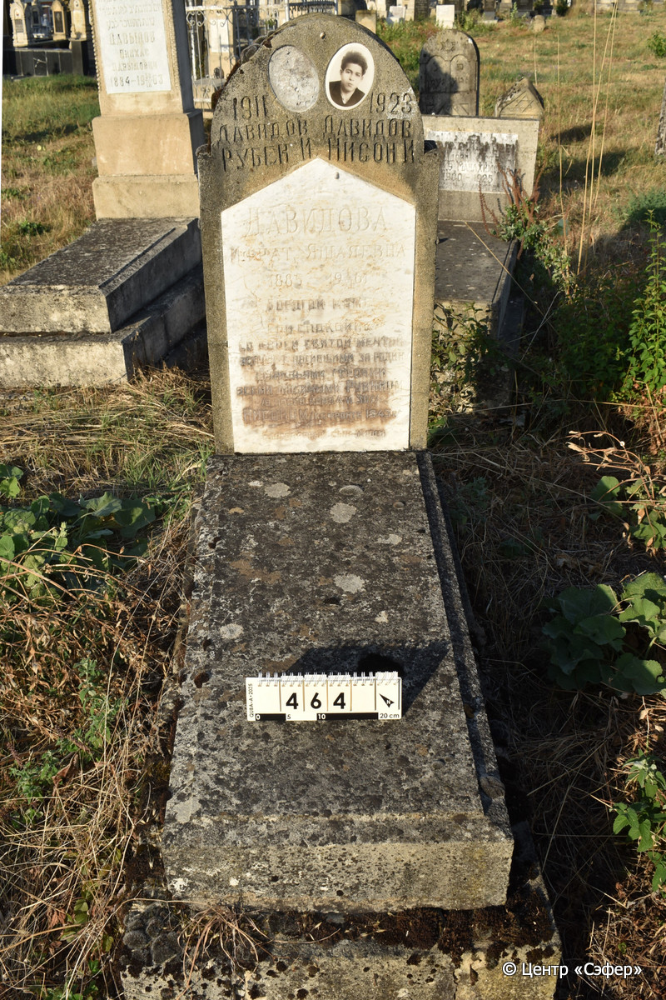

::: {style="font-size: 1em; margin-bottom: 1.2em"}
[Куба (центральное)](../cemeteries/QBA.html) > QBA0464
:::

```{r}
suppressPackageStartupMessages(library(tidyverse))
```


:::: {.columns}

::: {.column width="20%"}

```{r}
#| lightbox:
#|   group: photos




```
:::

::: {.column width="5%"}
:::

::: {.column width="74%"}

::: {.custom-frame}
::: {.name-style}
**ДАВИДОВА Ифрат, дочь Йешайи (Яшаяевна)**
:::

::: {style="font-size: 1.2em; color: #929292;"}

:::

:::: {.columns .date-panel .align-items-center}
::: {.column width="1.5em" .text-center}
{width=1.3em .nolightbox}
:::

::: {.column style="width: fit-content; padding-left: 0.4em; padding-right: 4em;"}
-.-.1885 

[--]{style="color: #929292"}
:::

::: {.column width="1.5em" .text-center}
{width=1.3em .nolightbox}
:::

::: {.column style="width: fit-content; padding-left: 0.4em;"}
01.11.1961 

[--]{style="color: #929292"}
:::

::::

---

::: {.name-style}
**ДАВИДОВ Нисан (Нисон)**
:::

::: {style="font-size: 1.2em; color: #929292;"}

:::

:::: {.columns .date-panel .align-items-center}
::: {.column width="1.5em" .text-center}
{width=1.3em .nolightbox}
:::

::: {.column style="width: fit-content; padding-left: 0.4em; padding-right: 4em;"}
-.-.1923 

[--]{style="color: #929292"}
:::

::: {.column width="1.5em" .text-center}
{width=1.3em .nolightbox}
:::

::: {.column style="width: fit-content; padding-left: 0.4em;"}
-.-.1943 

[--]{style="color: #929292"}
:::

::::

---

::: {.name-style}
**ДАВИДОВ Реувен (Рубен)**
:::

::: {style="font-size: 1.2em; color: #929292;"}

:::

:::: {.columns .date-panel .align-items-center}
::: {.column width="1.5em" .text-center}
{width=1.3em .nolightbox}
:::

::: {.column style="width: fit-content; padding-left: 0.4em; padding-right: 4em;"}
-.-.1911 

[--]{style="color: #929292"}
:::

::: {.column width="1.5em" .text-center}
{width=1.3em .nolightbox}
:::

::: {.column style="width: fit-content; padding-left: 0.4em;"}
04.06.1930 

[--]{style="color: #929292"}
:::

::::

:::

::: {.panel-tabset}

#### Эпитафия

```{r}
tibble(`Оригинал` = "справа
1923
Давидов
Нисон И.

слева
1911
Давидов
Рубен И.

по центру
Давидова
Ифрат Яшаяевна
1885 - 19 1/XI 61 г
Дорогой маме
Спи спокойно
со своей святой мечтой
о встрече с погибшими за Родину
сыновьями - героями
всеми любимыми Рувином
/в посев. комп. 4. VI 30 г. /
Нисоном /на фронте 1943 г. /
Благодарный сын Миши.",
       `Перевод` = "_R_
См. оригинал
 
 

_L_
См. оригинал
 
 

_C_
См. оригинал
 
 
 
 
 
 
 
 
 

") |>
  mutate(`Оригинал` = str_split(`Оригинал`, "
"),
         `Перевод` = str_split(`Перевод`, "
")) |>
  unnest_longer(c(`Оригинал`, `Перевод`)) |> 
  mutate(id = 1:n()) |> 
  relocate(id, .before = Перевод) |> 
  rename(` ` = id) |> 
  knitr::kable(align = c("r", "c", "l"))
```

|||
|-|---|
|Примечания| |
|Язык      |русский    |
|Метки     |преждевременная смерть, военные действия    |
: {.striped .custom-table tbl-colwidths="[25,75]"}

#### Памятник

|||
|-|---|
|Тип памятника   |L-образный                                                                         |
|Материал        |известняк, мрамор (мраморная вставка для текста, керамический медальон с фотографией. Второй отсутствует, осталась под него ниша. Следы эрозии, трещины, цементный раствор. Часть основания ушла в землю.)                                                     |
|Размеры         |108×49×13  --- стела; 21×63×118  --- плита; 37×80×170  --- основание                                                                        |
|Тип декора      |архитектурно-орнаментальный                                                                        |
|Элементы декора |полукруглое завершение, фигурная вставка для текста, медальон с фотографией                                                                          |
|Координаты      |[41.37087927, 48.50772068](https://www.google.com/maps/place/41.37087927, 48.50772068)                    |
: {.striped .custom-table tbl-colwidths="[25,75]"}

#### Источник

|                          |                 |
|--------------------------|-----------------|
|Место хранения        |Архив полевых исследований Центра «Сэфер»        |
|Контакты              |students@sefer.ru       |
|Ссылка                |[https://sfira.org](https://sfira.org) |
|Исходный ID           |     |
|Условия использования |[CC BY-NC 4.0](https://creativecommons.org/licenses/by-nc/4.0/deed.ru)        |
: {.striped .custom-table tbl-colwidths="[25,75]"}

:::

:::

::::

