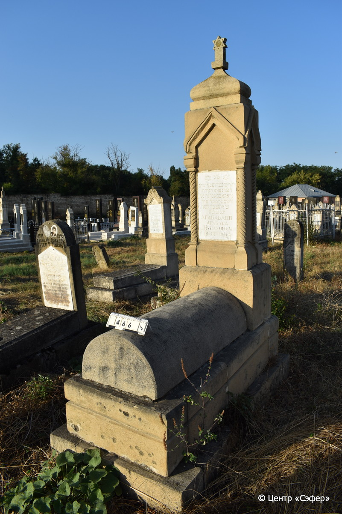
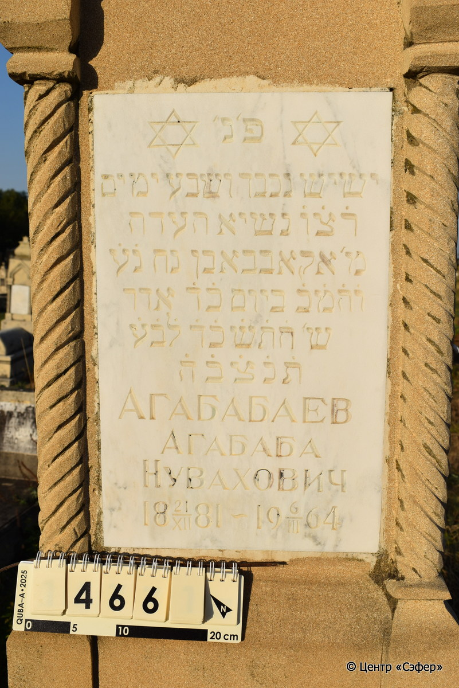

::: {style="font-size: 1em; margin-bottom: 1.2em"}
[Куба (центральное)](../cemeteries/QBA.html) > QBA0466
:::

```{r}
suppressPackageStartupMessages(library(tidyverse))
```


:::: {.columns}

::: {.column width="20%"}

```{r}
#| lightbox:
#|   group: photos




```
:::

::: {.column width="1.5em"}
:::

::: {.column width="74%"}

::: {.custom-frame}
::: {.name-ru-style}
**АГАБАБАЕВ Агабаба, сын Ноаха (Нувахович)**
:::

::: {.name-he-style}
אקאבבא בן נח
:::

:::: {.columns .date-panel style="display: flex; align-items: top; margin-top: 0.8em;"}
::: {.column .text-center style="width: fit-content; flex: 0 0 auto;"}
{width=1.5em .nolightbox}
:::

::: {.column style="flex: 0 0 auto; width: fit-content; padding-left: 0.8em; padding-right: 3.5em;"}
21.12.1881 

[--]{style="color: #929292"}
:::

::: {.column .text-center style="width: fit-content; flex: 0 0 auto;"}
{width=1.5em .nolightbox}
:::

::: {.column style="flex: 0 0 auto; width: fit-content; padding-left: 0.8em;"}
06.03.1964 

[24.Ad.5724]{style="color: #929292"}
:::

::::

:::

::: {.panel-tabset}

#### Эпитафия

```{r}
tibble(`Оригинал` = "פ׳ נ׳
ישיש נכבד ושבע ימים
ר֗צ֗ו֗ נשיא העדה
מ׳ אקאבבא בן נח נ֗ע֗
ו֗ה֗מ֗כ֗ ביום כ֗ד֗ אדר
ש׳ ה֗ת֗ש֗כ֗ד֗ ל֗ב֗ע֗
ת֗נ֗צ֗ב֗ה֗
АГАБАБАЕВ
АГАБАБА
НУВАХОВИЧ
18 21/XII 81 - 19 6/III 64",
       `Перевод` = "Здесь покоится
пожилой и уважаемый, [ушедший] в преклонном возрасте,
правдолюбивый и милостивый, глава общины,
господин Агабаба, сын Ноаха, да упокоится он в раю, 
во славе, [скончавшийся] двадцать четвертого адара
5724 года от сотворения мира,
да будет душа его завязана в узле жизни
Агабабаев
Агабаба
Нувахович
21.12.1881 - 06.03.1964") |>
  mutate(`Оригинал` = str_split(`Оригинал`, "
"),
         `Перевод` = str_split(`Перевод`, "
")) |>
  unnest_longer(c(`Оригинал`, `Перевод`)) |> 
  mutate(id = 1:n()) |> 
  relocate(id, .before = Перевод) |> 
  rename(` ` = id) |> 
  knitr::kable(align = c("r", "c", "l"))
```

---

:::: {.custom-table-wrap}
::: {.list-table .borderless header-rows=0 aligns="l,l" tbl-colwidths="[21,79]"}
- - Примечания
  -  

- - Язык
  - иврит, русский

- - Метки
  -  

:::
::::

#### Памятник

:::: {.custom-table-wrap}
::: {.list-table .borderless header-rows=0 aligns="l,l" tbl-colwidths="[21,79]"}
- - Тип памятника
  - L-образный

- - Материал
  - известняк, мрамор (мраморная вставка для текста на стеле, следы эрозии, цементный раствор, блоки основания смещены)

- - Размеры
  - 220×62×40  --- стела; 31×50×115  --- Саркофаг; 55×90×175  --- основание

- - Тип декора
  - архитектурно-орнаментальный, традиционная символика

- - Элементы декора
  - архитектурное навершие со звездой Давида. Стрельчатые арки на витых полуколоннах. Две звезды Давида на мраморной вставке с текстом.

- - Координаты
  - 41.37086654, 48.50773285 [Показать на карте](https://www.google.com/maps/place/41.37086654, 48.50773285){style="margin-left: 1em"}

:::
::::

#### Источник

:::: {.custom-table-wrap}
::: {.list-table .borderless header-rows=0 aligns="l,l" tbl-colwidths="[21,79]"}
- - Место хранения
  - Архив полевых исследований Центра «Сэфер»

- - Контакты
  - students@sefer.ru

- - Ссылка
  - [https://sfira.org](https://sfira.org)

- - Исходный ID
  -  

- - Условия использования
  - [CC BY-NC 4.0](https://creativecommons.org/licenses/by-nc/4.0/deed.ru)

:::
::::

:::

:::

:::

