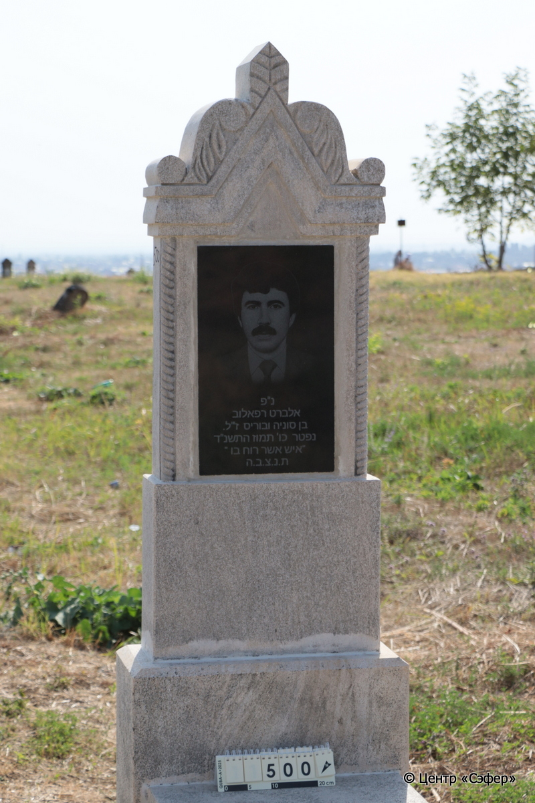
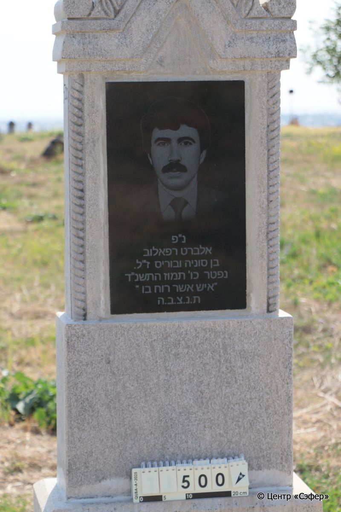
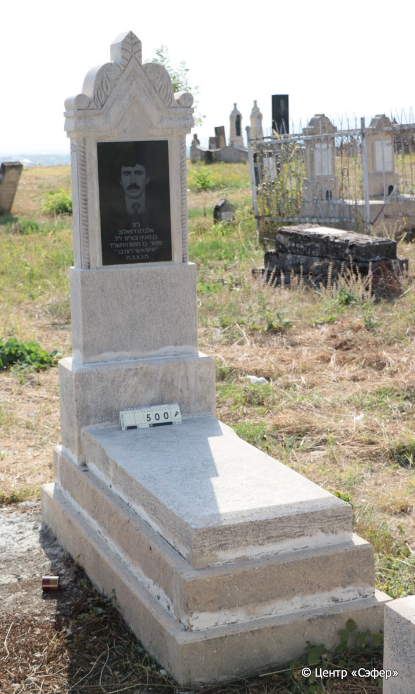

::: {style="font-size: 1em; margin-bottom: 1.2em"}
[Куба (центральное)](../cemeteries/QBA.html) > QBA0500
:::

```{r}
suppressPackageStartupMessages(library(tidyverse))
```


:::: {.columns}

::: {.column width="20%"}

```{r}
#| lightbox:
#|   group: photos





```
:::

::: {.column width="5%"}
:::

::: {.column width="74%"}

::: {.custom-frame}
::: {.name-style}
**РАФАИЛОВ Альберт, сын Бориса**
:::

::: {style="font-size: 1.2em; color: #929292;"}
אלברט בן בוריס
:::

:::: {.columns .date-panel .align-items-center}
::: {.column width="1.5em" .text-center}
{width=1.3em .nolightbox}
:::

::: {.column style="width: fit-content; padding-left: 0.4em; padding-right: 4em;"}
-- 

[--]{style="color: #929292"}
:::

::: {.column width="1.5em" .text-center}
{width=1.3em .nolightbox}
:::

::: {.column style="width: fit-content; padding-left: 0.4em;"}
05.07.1994* 

[26.Ta.5754]{style="color: #929292"}
:::

::::

:::

::: {.panel-tabset}

#### Эпитафия

```{r}
tibble(`Оригинал` = "נ״פ
אלברט רפאלוב
בן סוניה ובוריס ז״ל.
נפטר כו׳ תמוז התשנ״ד
איש אשר רוח בו
ת.נ.צ.ב.ה.",
       `Перевод` = "Здесь покоится 
Альберт Рафаилов,
сын Сони и Бориса, да будет благословенна его память.
Скончался 26 таммуза 5754 <года>,
«человек, в котором есть дух».*
Да будет душа его завязана в узле жизни.") |>
  mutate(`Оригинал` = str_split(`Оригинал`, "
"),
         `Перевод` = str_split(`Перевод`, "
")) |>
  unnest_longer(c(`Оригинал`, `Перевод`)) |> 
  mutate(id = 1:n()) |> 
  relocate(id, .before = Перевод) |> 
  rename(` ` = id) |> 
  knitr::kable(align = c("r", "c", "l"))
```

|||
|-|---|
|Примечания|*Цит. Числа 27:18|
|Язык      |иврит    |
|Метки     |     |
: {.striped .custom-table tbl-colwidths="[25,75]"}

#### Памятник

|||
|-|---|
|Тип памятника   |L-образный                                                                         |
|Материал        |известняк, гранит (незначительные следы эрозии и цементного раствора)                                                     |
|Размеры         |168×60×30  --- стела; 13×55×119  --- плита; 16×74×170  --- основание                                                                        |
|Тип декора      |архитектурно-орнаментальный, растительный, портретный                                                                        |
|Элементы декора |в завершении волюты с растительным орнаментом и геометрическим узором; по бокам витые полуколонны; гранитная табличка с портретом                                                                          |
|Координаты      |[41.37100737, 48.50775148](https://www.google.com/maps/place/41.37100737, 48.50775148)                    |
: {.striped .custom-table tbl-colwidths="[25,75]"}

#### Источник

|                          |                 |
|--------------------------|-----------------|
|Место хранения        |Архив полевых исследований Центра «Сэфер»        |
|Контакты              |students@sefer.ru       |
|Ссылка                |[https://sfira.org](https://sfira.org) |
|Исходный ID           |     |
|Условия использования |[CC BY-NC 4.0](https://creativecommons.org/licenses/by-nc/4.0/deed.ru)        |
: {.striped .custom-table tbl-colwidths="[25,75]"}

:::

:::

::::

