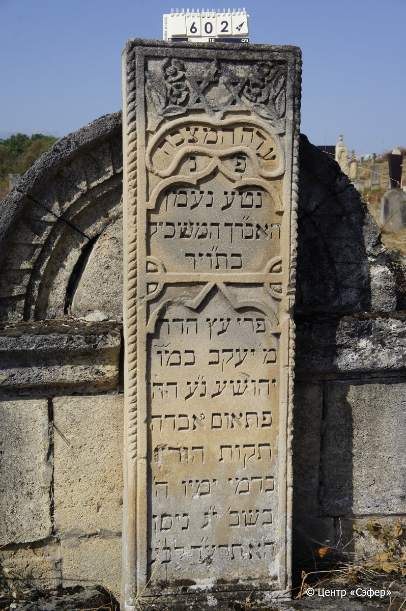
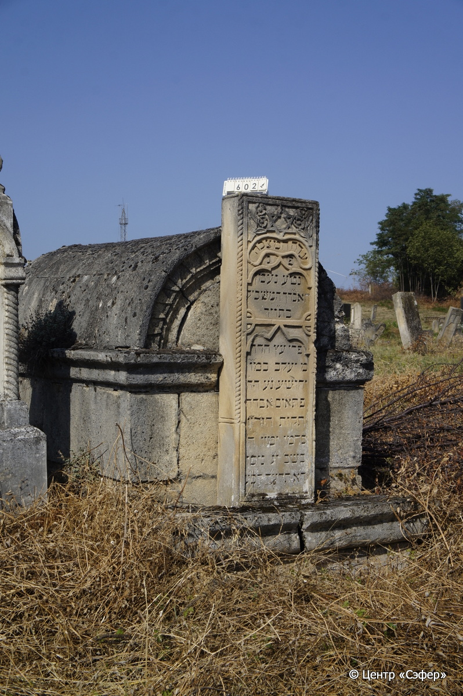
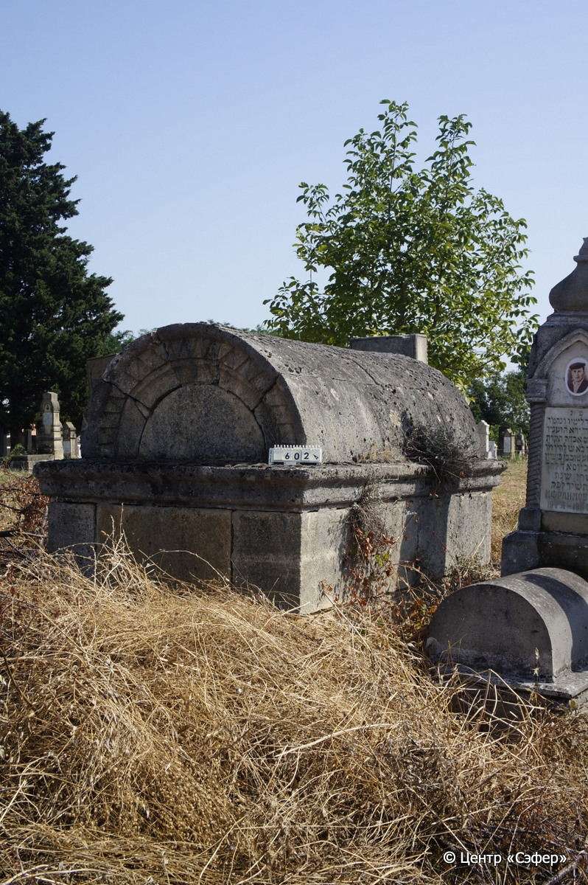

::: {style="font-size: 1em; margin-bottom: 1.2em"}
[Куба (центральное)](../cemeteries/QBA.html) > QBA0602
:::

```{r}
suppressPackageStartupMessages(library(tidyverse))
```


:::: {.columns}

::: {.column width="20%"}

```{r}
#| lightbox:
#|   group: photos





```
:::

::: {.column width="5%"}
:::

::: {.column width="74%"}

::: {.custom-frame}
::: {.name-style}
**Яаков, сын Йехошуа**
:::

::: {style="font-size: 1.2em; color: #929292;"}
יעקב בן יהושע
:::

:::: {.columns .date-panel .align-items-center}
::: {.column width="1.5em" .text-center}
{width=1.3em .nolightbox}
:::

::: {.column style="width: fit-content; padding-left: 0.4em; padding-right: 4em;"}
-- 

[--]{style="color: #929292"}
:::

::: {.column width="1.5em" .text-center}
{width=1.3em .nolightbox}
:::

::: {.column style="width: fit-content; padding-left: 0.4em;"}
09.04.1914* 

[13.Ni.5674]{style="color: #929292"}
:::

::::

:::

::: {.panel-tabset}

#### Эпитафия

```{r}
tibble(`Оригинал` = "עדה המצבה
פ׳נ׳
נטע נעמן
האב״רך המשכיל
בת״ויר
פרי עץ הדר*
מ׳ יעקב במו֮
יהושע נ״ע הה
פּתאום אבדה
תקות הוריו
בדמי ימיו ה׳
בשב׳ י״ג ניסן
הא תרעד לב׳ע׳",
       `Перевод` = "Свидетель сей камень.
Здесь покоится 
прекрасный саженец,
молодой человек, просвещённый
в Торе и богобоязненный,
плод прекрасного древа,
господин Яаков, сын господина
Йехоше, душа его в раю. Он был,
и вдруг пропала 
надежда родителей его,
в расцвете дней, в четверг,
13 нисана
5674 года от сотворения мира.") |>
  mutate(`Оригинал` = str_split(`Оригинал`, "
"),
         `Перевод` = str_split(`Перевод`, "
")) |>
  unnest_longer(c(`Оригинал`, `Перевод`)) |> 
  mutate(id = 1:n()) |> 
  relocate(id, .before = Перевод) |> 
  rename(` ` = id) |> 
  knitr::kable(align = c("r", "c", "l"))
```

|||
|-|---|
|Примечания|*Левит 23:40|
|Язык      |иврит    |
|Метки     |знаток Писания, юноша    |
: {.striped .custom-table tbl-colwidths="[25,75]"}

#### Памятник

|||
|-|---|
|Тип памятника   |L-образный                                                                         |
|Материал        |песчаник, известняк (следы эрозии, скол у основания, трещины)                                                     |
|Размеры         |175×44×18  --- стела; 160×150×290  --- саркофаг                                                                        |
|Тип декора      |архитектурно-орнаментальный, растительный, традиционная символика                                                                        |
|Элементы декора |звезда Давида в окружении цветов, три фигурные рамки для текста, витые полуколонны, полукруглое завершение саркофага                                                                          |
|Координаты      |[41.37080223, 48.50826839](https://www.google.com/maps/place/41.37080223, 48.50826839)                    |
: {.striped .custom-table tbl-colwidths="[25,75]"}

#### Источник

|                          |                 |
|--------------------------|-----------------|
|Место хранения        |Архив полевых исследований Центра «Сэфер»        |
|Контакты              |students@sefer.ru       |
|Ссылка                |[https://sfira.org](https://sfira.org) |
|Исходный ID           |     |
|Условия использования |[CC BY-NC 4.0](https://creativecommons.org/licenses/by-nc/4.0/deed.ru)        |
: {.striped .custom-table tbl-colwidths="[25,75]"}

:::

:::

::::

