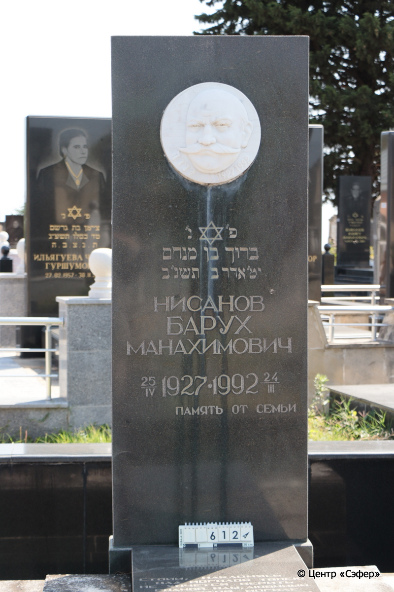
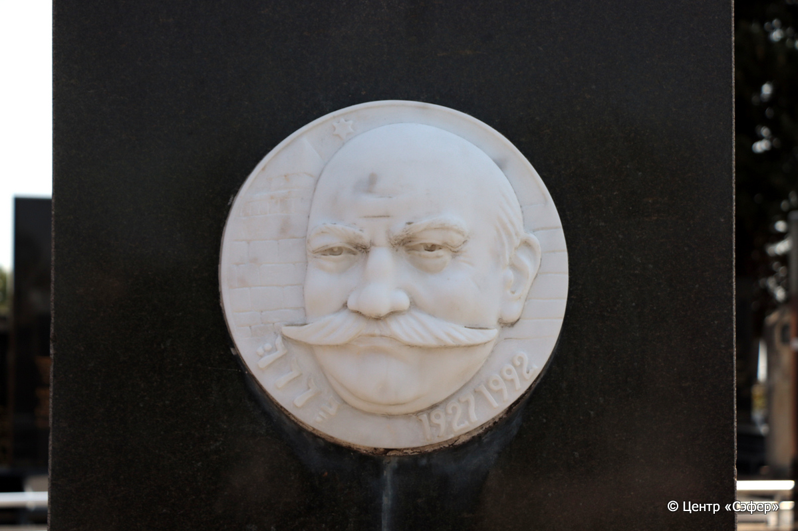
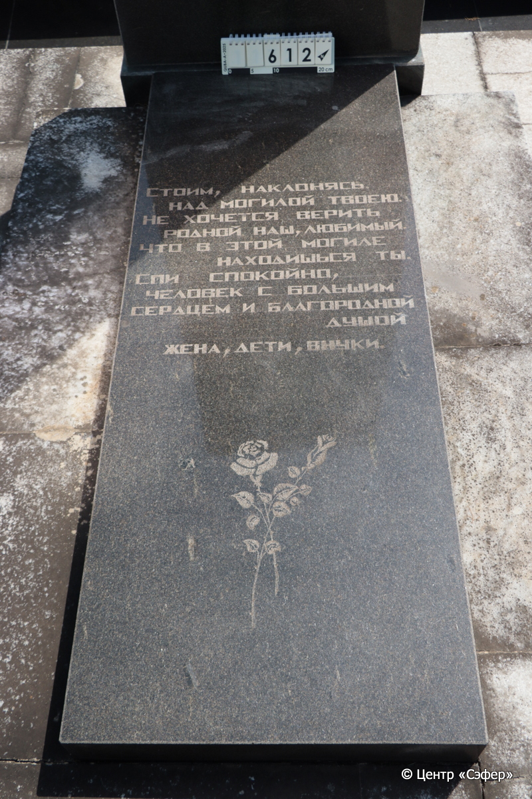
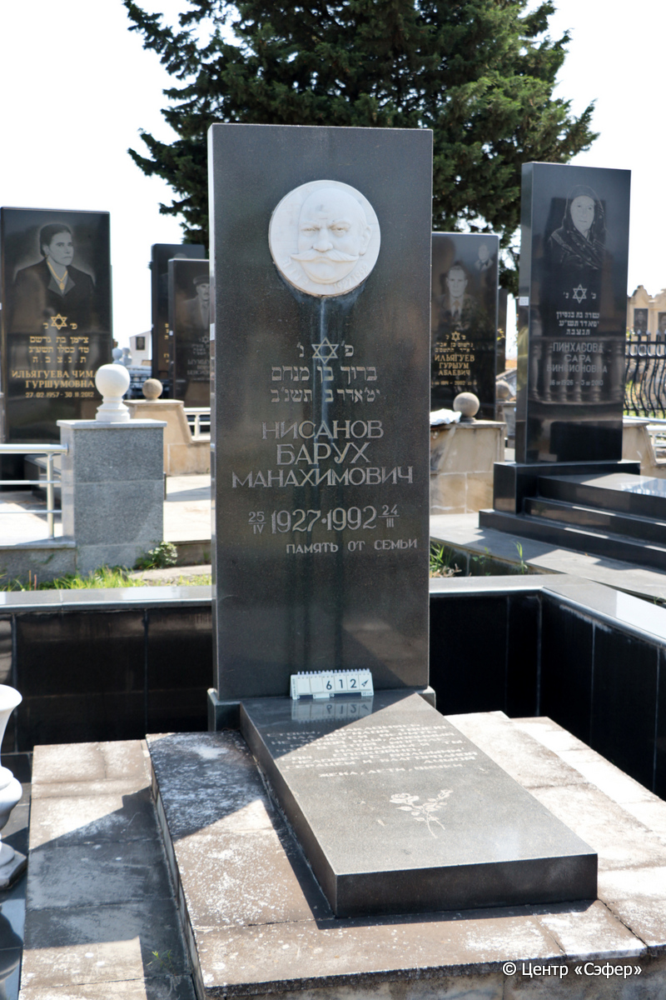
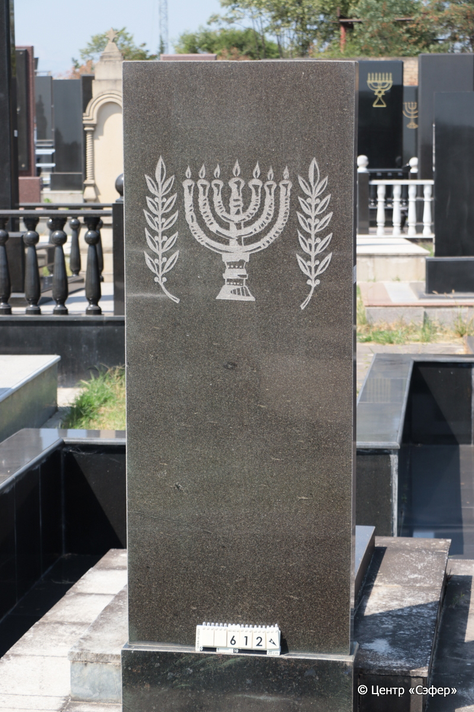

::: {style="font-size: 1em; margin-bottom: 1.2em"}
[Куба (центральное)](../cemeteries/QBA.html) > QBA0612
:::

```{r}
suppressPackageStartupMessages(library(tidyverse))
```


:::: {.columns}

::: {.column width="20%"}

```{r}
#| lightbox:
#|   group: photos







```
:::

::: {.column width="1.5em"}
:::

::: {.column width="74%"}

::: {.custom-frame}
::: {.name-ru-style}
**НИСАНОВ Барух, сын Менахема (Барух Манахимович)**
:::

::: {.name-he-style}
ברוך בן מנחם
:::

:::: {.columns .date-panel style="display: flex; align-items: top; margin-top: 0.8em;"}
::: {.column .text-center style="width: fit-content; flex: 0 0 auto;"}
{width=1.4em .nolightbox}
:::

::: {.column style="flex: 0 0 auto; width: fit-content; padding-left: 0.8em; padding-right: 3.5em;"}
25.04.1927 

[--]{style="color: #929292"}
:::

::: {.column .text-center style="width: fit-content; flex: 0 0 auto;"}
{width=1.4em .nolightbox}
:::

::: {.column style="flex: 0 0 auto; width: fit-content; padding-left: 0.8em;"}
24.03.1992 

[19.Ad2.5752]{style="color: #929292"}
:::

::::

:::

::: {.panel-tabset}

#### Эпитафия

```{r}
tibble(`Оригинал` = "1927 1992 ברוך
פ׳נ׳
ברוך בן מנחם
יט׳ אדר ב תשנ׳ב
Нисанов
Барух
Манахимович
25/IV 1927•1992 24/III
 Память от семьи

снизу
Стоим, наклонясь, 
Над могилой твоею.
Не хочется верить
Родной наш, любимый.
Что в этой могиле 
находишься ты.
Спи спокойно,
человек с большим
сердцем и благородной
душой
жена, дети, внуки.",
       `Перевод` = "Барух 1927 - 1992.
Здесь покоится
Барух, сын Менахема.
19 адара-II {5}752 года.
Нисанов
Барух
Манахимович
25.04.1927 - 24.03.1992
Память от семьи.

_B_
Стоим, наклонясь, 
Над могилой твоею.
Не хочется верить,
Родной наш, любимый,
Что в этой могиле 
находишься ты.
Спи спокойно,
человек с большим
сердцем и благородной
душой.
Жена, дети, внуки.") |>
  mutate(`Оригинал` = str_split(`Оригинал`, "
"),
         `Перевод` = str_split(`Перевод`, "
")) |>
  unnest_longer(c(`Оригинал`, `Перевод`)) |> 
  mutate(id = 1:n()) |> 
  relocate(id, .before = Перевод) |> 
  rename(` ` = id) |> 
  knitr::kable(align = c("r", "c", "l"))
```

---

:::: {.custom-table-wrap}
::: {.list-table .borderless header-rows=0 aligns="l,l" tbl-colwidths="[21,79]"}
- - Примечания
  -  

- - Язык
  - иврит, русский

- - Метки
  -  

:::
::::

#### Памятник

:::: {.custom-table-wrap}
::: {.list-table .borderless header-rows=0 aligns="l,l" tbl-colwidths="[21,79]"}
- - Тип памятника
  - L-образный

- - Материал
  - гранит, мрамор (цементный раствор, мраморный портрет, мраморное основание)

- - Размеры
  - 194×70×20  --- стела; 16×110×167  --- плита; 32×182×250  --- основание

- - Тип декора
  - растительный, традиционная символика, портретный

- - Элементы декора
  - скульптурный портрет, звезда Давида на лицевой стороне, менора и растительный орнамент на оборотной стороне, цветы на плите

- - Координаты
  - 41.37118114, 48.50815509 [Показать на карте](https://www.google.com/maps/place/41.37118114, 48.50815509){style="margin-left: 1em"}

:::
::::

#### Источник

:::: {.custom-table-wrap}
::: {.list-table .borderless header-rows=0 aligns="l,l" tbl-colwidths="[21,79]"}
- - Место хранения
  - Архив полевых исследований Центра «Сэфер»

- - Контакты
  - students@sefer.ru

- - Ссылка
  - [https://sfira.org](https://sfira.org)

- - Исходный ID
  -  

- - Условия использования
  - [CC BY-NC 4.0](https://creativecommons.org/licenses/by-nc/4.0/deed.ru)

:::
::::

:::

:::

:::

