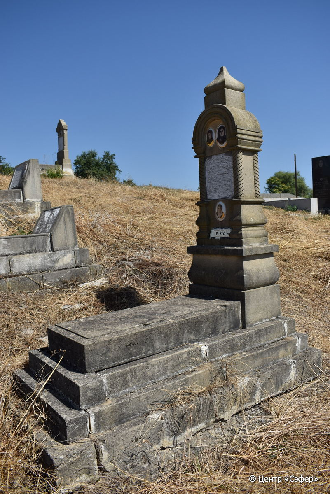
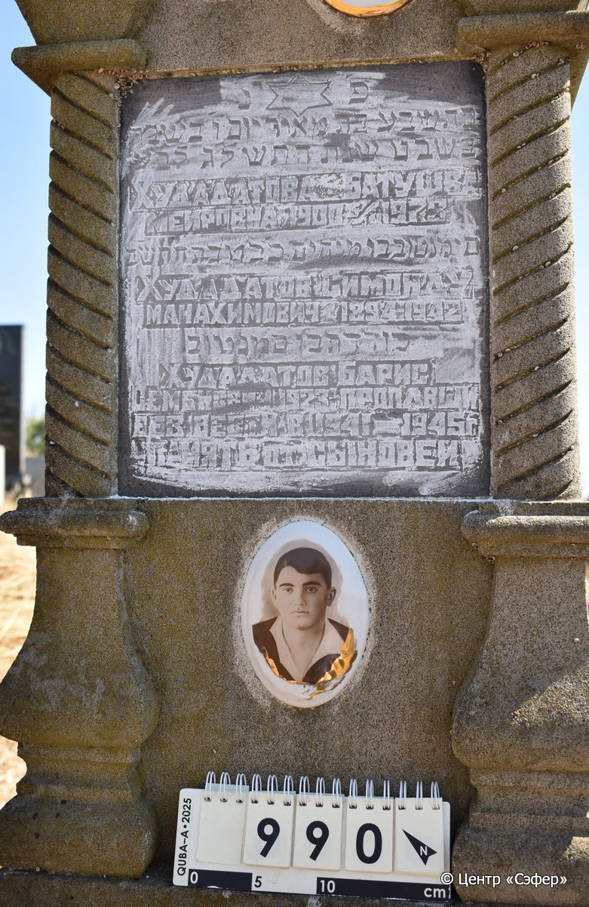

::: {style="font-size: 1em; margin-bottom: 1.2em"}
[Куба (центральное)](../cemeteries/QBA.html) > QBA0990
:::

```{r}
suppressPackageStartupMessages(library(tidyverse))
```


:::: {.columns}

::: {.column width="20%"}

```{r}
#| lightbox:
#|   group: photos




```
:::

::: {.column width="5%"}
:::

::: {.column width="74%"}

::: {.custom-frame}
::: {.name-style}
**ХУДАДАТОВА Бат-Шева, дочь Меира (Батушва Меировна)**
:::

::: {style="font-size: 1.2em; color: #929292;"}
בתשבע בת מאיר
:::

:::: {.columns .date-panel .align-items-center}
::: {.column width="1.5em" .text-center}
{width=1.3em .nolightbox}
:::

::: {.column style="width: fit-content; padding-left: 0.4em; padding-right: 4em;"}
-.-.1900 

[--]{style="color: #929292"}
:::

::: {.column width="1.5em" .text-center}
{width=1.3em .nolightbox}
:::

::: {.column style="width: fit-content; padding-left: 0.4em;"}
05.01.1973 

[02.Sh.5733]{style="color: #929292"}
:::

::::

---

::: {.name-style}
**ХУДАДАТОВ Симан Тов, сын Менахема (Симонду Манахимович)**
:::

::: {style="font-size: 1.2em; color: #929292;"}
סימנטוב בן מנחם
:::

:::: {.columns .date-panel .align-items-center}
::: {.column width="1.5em" .text-center}
{width=1.3em .nolightbox}
:::

::: {.column style="width: fit-content; padding-left: 0.4em; padding-right: 4em;"}
-.-.1894 

[--]{style="color: #929292"}
:::

::: {.column width="1.5em" .text-center}
{width=1.3em .nolightbox}
:::

::: {.column style="width: fit-content; padding-left: 0.4em;"}
-.-.1942 

[22.Te.5702]{style="color: #929292"}
:::

::::

---

::: {.name-style}
**ХУДАДАТОВ Худадат, сын Симана Това (Борис Семенович)**
:::

::: {style="font-size: 1.2em; color: #929292;"}
כודדת בן סימנטוב
:::

:::: {.columns .date-panel .align-items-center}
::: {.column width="1.5em" .text-center}
{width=1.3em .nolightbox}
:::

::: {.column style="width: fit-content; padding-left: 0.4em; padding-right: 4em;"}
-.-.1923 

[--]{style="color: #929292"}
:::

::: {.column width="1.5em" .text-center}
{width=1.3em .nolightbox}
:::

::: {.column style="width: fit-content; padding-left: 0.4em;"}
-.-.1941/1945 

[--]{style="color: #929292"}
:::

::::

:::

::: {.panel-tabset}

#### Эпитафия

```{r}
tibble(`Оригинал` = "פ׳נ׳
בתשבע בת מאיר יום ו׳ בשבת
ב֘ שבט שנת התשל׳ג לב֮ע
Худадатова Батушва
Меировна 1900 - 5/I 1973
סימנטוב בן מנחים כ֮ב טבת התש֮ב
Худадатов Симонду
Манахимович 1894-1942
כודדת בן סמנטוב
Худадатов Барис
Семенович 1923. пропавщи
без вести в 1941-1945 г.
память от сыновей",
       `Перевод` = "Здесь покоится
Батшева, дочь Меира. Пятница,
2 швата года 5733 от сотворения мира.
Худадатова Батушва
Меировна 1900 - 5/I 1973
Симантов, сын Менахема. 22 тевета 5702 года.
Худадатов Симонду
Манахимович 1894-1942.
Худадат, сын Симантова.
Худадатов Борис
Семенович, 1923 г. рождения, пропавший
без вести в 1941-1945 гг..
Память от сыновей.") |>
  mutate(`Оригинал` = str_split(`Оригинал`, "
"),
         `Перевод` = str_split(`Перевод`, "
")) |>
  unnest_longer(c(`Оригинал`, `Перевод`)) |> 
  mutate(id = 1:n()) |> 
  relocate(id, .before = Перевод) |> 
  rename(` ` = id) |> 
  knitr::kable(align = c("r", "c", "l"))
```

|||
|-|---|
|Примечания| |
|Язык      |иврит, русский    |
|Метки     |     |
: {.striped .custom-table tbl-colwidths="[25,75]"}

#### Памятник

|||
|-|---|
|Тип памятника   |L-образный                                                                         |
|Материал        |песчаник, известняк (следы эрозии,мраморная табличка для текста,три керамических медальона)                                                     |
|Размеры         |198×60×41  --- стела; 16×55×117  --- плита; 25×95×196  --- основание                                                                        |
|Тип декора      |архитектурно-орнаментальный, традиционная символика, портретный                                                                        |
|Элементы декора |фигурное навершие,портал с витыми полуколоннами,три фотопортрета на медальонах, звезда Давида на вставке                                                                          |
|Координаты      |[41.37091597, 48.50943344](https://www.google.com/maps/place/41.37091597, 48.50943344)                    |
: {.striped .custom-table tbl-colwidths="[25,75]"}

#### Источник

|                          |                 |
|--------------------------|-----------------|
|Место хранения        |Архив полевых исследований Центра «Сэфер»        |
|Контакты              |students@sefer.ru       |
|Ссылка                |[https://sfira.org](https://sfira.org) |
|Исходный ID           |     |
|Условия использования |[CC BY-NC 4.0](https://creativecommons.org/licenses/by-nc/4.0/deed.ru)        |
: {.striped .custom-table tbl-colwidths="[25,75]"}

:::

:::

::::

