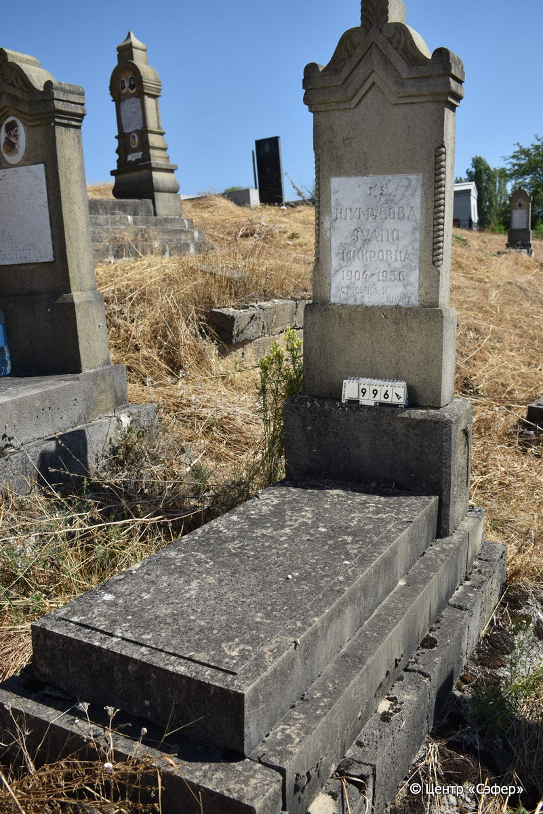
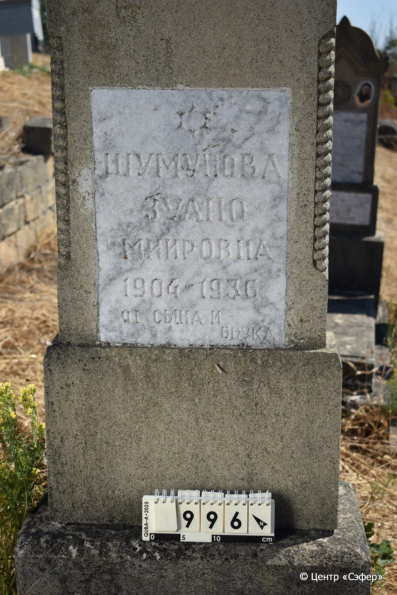

::: {style="font-size: 1em; margin-bottom: 1.2em"}
[Куба (центральное)](../cemeteries/QBA.html) > QBA0996
:::

```{r}
suppressPackageStartupMessages(library(tidyverse))
```


:::: {.columns}

::: {.column width="20%"}

```{r}
#| lightbox:
#|   group: photos




```
:::

::: {.column width="5%"}
:::

::: {.column width="74%"}

::: {.name-style}
ШУМУНОВА Зулпо [Миировна]
:::

::: {style="font-size: 1.2em;"}

:::

:::: {.columns style="margin-top: 1em"}
::: {.column width="5%"}
{width=1.3em .nolightbox}
:::

::: {.column style="width: 40%; padding-left: 0.2em;"}
-.-.1904 [/]{style="color: #adb5bd"} --
:::

::: {.column width="5%"}
{width=1.3em .nolightbox}
:::

::: {.column style="width: 50%; padding-left: 0.2em;"}
-.-.1936 [/]{style="color: #adb5bd"} --
:::

::::


::: {.panel-tabset}

#### Эпитафия

```{r}
tibble(`Оригинал` = "Шумунова
Зулпо
Миировна
1904-1936
от сына и 
внука",
       `Перевод` = "См. оригинал
 
 
 

") |>
  mutate(`Оригинал` = str_split(`Оригинал`, "
"),
         `Перевод` = str_split(`Перевод`, "
")) |>
  unnest_longer(c(`Оригинал`, `Перевод`)) |> 
  mutate(id = 1:n()) |> 
  relocate(id, .before = Перевод) |> 
  rename(` ` = id) |> 
  knitr::kable(align = c("r", "c", "l"))
```

|||
|-|---|
|**Примечания**| |
|**Язык**      |русский    |
|**Метки**     |     |
: {tbl-colwidths="[25,75]"}

#### Памятник

|||
|-|---|
|**Тип памятника**   |L-образный                                                                         |
|**Материал**        |песчаник (следы эрозии, мраморная вставка для текста)                                                     |
|**Размеры**         |163×55×27  --- стела; 14×52×117  --- плита; 17×77×169  --- основание                                                                        |
|**Тип декора**      |архитектурно-орнаментальный, растительный, традиционная символика                                                                        |
|**Элементы декора** |фигурное завершение с волютами и растительным орнаментом,конек,витые полуколонны, звезда Давида на вставке                                                                          |
|**Координаты**      |[41.37086501, 48.50940637](https://www.google.com/maps/place/41.37086501, 48.50940637)                    |
: {tbl-colwidths="[25,75]"}

#### Источник

|                          |                 |
|--------------------------|-----------------|
|**Место хранения**        |Архив полевых исследований Центра «Сэфер»        |
|**Контакты**              |students@sefer.ru       |
|**Ссылка**                |[https://sfira.org](https://sfira.org) |
|**Исходный ID**           |     |
|**Условия использования** |[CC BY-NC 4.0](https://creativecommons.org/licenses/by-nc/4.0/deed.ru)        |
: {tbl-colwidths="[25,75]"}

:::

:::

::::

